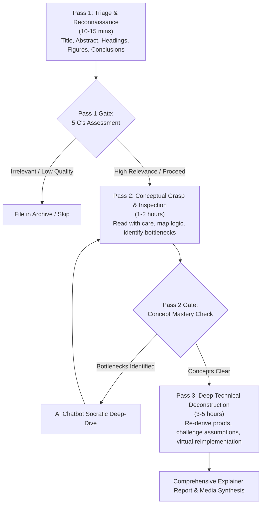

# Multipass Reader Skill

## Methodology
The Multipass Reader executes S. Keshav's classic three-pass method, upgraded for modern multimodal AI research and theoretical foundations:

## Pass 1: Triage & Reconnaissance (10-15 minutes)
- **Focus Areas**:
  1. Title, Abstract, Introduction.
  2. Section and subsection headings.
  3. All visual figures, tables, and architectural diagrams.
  4. Conclusion and future work section.
  5. Bibliography glance for familiar foundational papers.
- **The 5 C's Rubric**:
  - **Category**: What type of paper is this? (Empirical benchmark, theoretical lower bound, system architecture, survey).
  - **Context**: Which literature does it connect to? What existing barriers does it address?
  - **Correctness**: Are the foundational assumptions reasonable?
  - **Contributions**: What are the main claimed breakthroughs or innovations?
  - **Clarity**: Is the paper well-written and structured?
- **Pass 1 Output**:
  - `00 Index.md` and `01 Big picture.md` drafted in the Obsidian vault.
  - Decision: (A) Drop/archive, (B) Read later, (C) Proceed to Pass 2.

## Pass 2: Conceptual Grasp & Inspection (1-2 hours)
- **Focus Areas**:
  1. Read the entire paper sequentially, paying close attention to definitions and arguments.
  2. Skip dense algebraic proofs, lemmas, and appendices on this pass.
  3. Scrutinize all graphs, charts, axes, error bars, and benchmark comparisons.
  4. Flag unfamiliar terms, ambiguous concepts, and cognitive sticking points.
- **Learner Scaffolding**:
  - Compare new concepts against the learner's strong domain knowledge (e.g. distributed systems or PyTorch mechanics).
  - Create the initial Glossary entries with wikilinks (`[[13 Glossary]]`).
- **Pass 2 Output**:
  - Populated concept graph, claims sheet, and list of target questions for the AI Chatbot tutor.

## Pass 3: Deep Technical Deconstruction & Virtual Walk-Through (3-5 hours)
- **Focus Areas**:
  1. Scrutinize every assumption and derivation step.
  2. Virtually "re-create" the paper from scratch: if you had to prove this theorem or build this model pipeline, how would you do it?
  3. Identify hidden assumptions, fragile hyper-parameters, edge cases, and theoretical loopholes.
  4. Develop toy code or pseudocode implementing the core algorithm or proof structure.
- **Pass 3 Output**:
  - Proof/architecture deep dive notes (`05 Proof architecture.md`, `06 Flat case.md`, etc.).
  - Critical evaluation note (`08 What the result does not say.md`, `11 Reception and valid comments.md`).
  - Inputs for the Explainer Report and Gemini Notebook Media pipeline.
