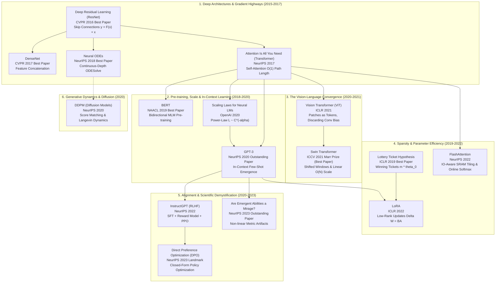
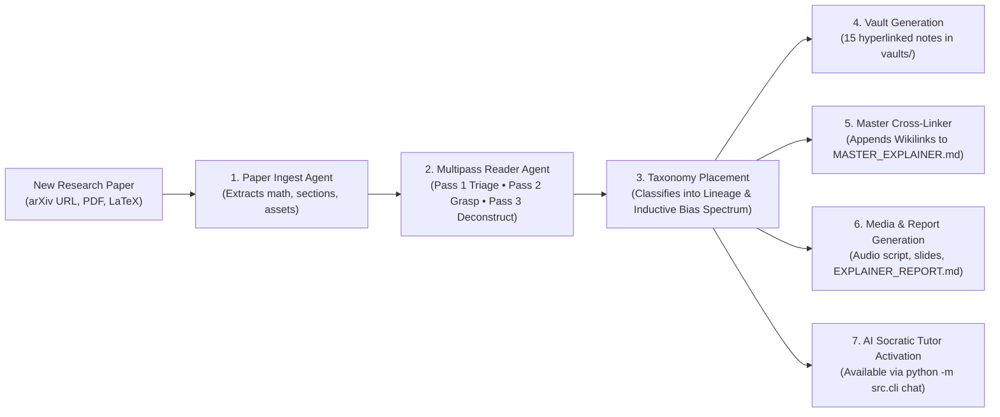

# Master Top-Level Explainer: The Intellectual Architecture of Modern Machine Learning

> A unified, cross-cutting synthesis connecting the seminal breakthroughs and top-venue award-winning papers in modern AI. Designed as the cognitive compass for the autonomous learner ([Alex Rivera](learner_profile.json)) and extensible to all future research papers.

---

## 1. The Grand Evolutionary Map of Modern AI

Modern machine learning is not an arbitrary grab-bag of disparate tricks; it is a coherent intellectual trajectory driven by the interplay between **inductive bias, empirical scaling, memory hierarchy, and mathematical alignment**.



---

## 2. The Six Intellectual Lineages

### Lineage 1: The Gradient Highway & Continuous Depth
- **The Core Problem**: In deep networks, gradients vanish or explode exponentially as backpropagation passes through dozens of non-linear matrix multiplications.
- **The Resolution**:
  - [[02_deep_residual_learning_resnet|ResNet]] introduced the identity shortcut mapping: $y = \mathcal{F}(x) + x$. The continuous gradient highway $+ I$ allowed training networks over 1,000 layers deep.
  - [[13_densenet_cvpr2017_best|DenseNet]] took this to the logical extreme by concatenating all prior feature maps ($x_\ell = H_\ell([x_0, \dots, x_{\ell-1}])$), maximizing feature reuse and gradient flow with minimal channel growth.
  - [[11_neural_odes_neurips2018_best|Neural ODEs]] asked: *What if layer depth is continuous rather than discrete?* By parameterizing $\frac{dh(t)}{dt} = f(h(t), t, \theta)$, it unified deep learning with dynamical systems and enabled constant $O(1)$ memory training via the adjoint sensitivity method.

### Lineage 2: The Self-Attention Revolution & Sequence Modeling
- **The Core Problem**: Recurrent architectures (RNNs, LSTMs) processed tokens sequentially, enforcing an $O(n)$ path length between distant tokens and preventing parallel training on GPUs.
- **The Resolution**:
  - [[01_attention_is_all_you_need|Attention Is All You Need]] discarded recurrence entirely. Scaled Dot-Product Attention ($\text{softmax}(\frac{QK^T}{\sqrt{d_k}})V$) connected any two tokens across an entire sequence in $O(1)$ operations, unlocking massive parallel training.
  - [[03_bert_bidirectional_transformers|BERT]] leveraged bidirectional self-attention and Masked Language Modeling (MLM), proving that task-agnostic pre-training followed by minimal fine-tuning crushed specialized NLP architectures.

### Lineage 3: The Scaling Paradigm & In-Context Learning
- **The Core Problem**: Does scaling model and data size hit diminishing returns, or does it unlock qualitatively new behaviors?
- **The Resolution**:
  - [[09_scaling_laws_neural_language_models|Scaling Laws for Neural LMs]] empirically proved that cross-entropy loss drops as a clean power-law function of compute ($C$), dataset size ($D$), and parameter count ($N$) over orders of magnitude.
  - [[04_gpt3_language_models_few_shot|GPT-3 (175B)]] demonstrated the emergence of **in-context learning**: prompt conditioning alone could perform arithmetic, translation, and coding without any gradient updates.
  - [[15_emergent_abilities_mirage_neurips2023_best|Emergent Abilities as a Mirage]] introduced critical scientific rigor: proving that sharp, discontinuous capability jumps are often artifacts of non-linear threshold evaluation metrics (e.g. Exact Match $(1-p)^L$) rather than discrete state changes in model representations.

### Lineage 4: The Vision-Language Convergence
- **The Core Problem**: Could vision discard hand-crafted spatial inductive biases (convolutions) and adopt the universal Transformer backbone?
- **The Resolution**:
  - [[06_vision_transformer_vit|Vision Transformer (ViT)]] partitioned images into $16 \times 16$ patches and fed them directly to standard Transformer encoders. Pre-trained on hundreds of millions of images, pure attention outperformed top CNNs.
  - [[14_swin_transformer_iccv2021_best|Swin Transformer]] introduced Shifted Window self-attention (SW-MSA), restoring hierarchical multi-scale feature pyramids and achieving linear $O(HW)$ computational complexity for dense vision tasks like detection and segmentation.

### Lineage 5: Parameter Efficiency, Sparsity & Hardware Co-Design
- **The Core Problem**: Fine-tuning and executing 100B+ parameter models exhausts GPU memory bandwidth and storage.
- **The Resolution**:
  - [[12_lottery_ticket_iclr2019_best|The Lottery Ticket Hypothesis]] showed that dense networks contain sparse sub-networks ($m \odot \theta_0$) that can train to full accuracy in isolation, revealing intrinsic over-parameterization.
  - [[08_lora_low_rank_adaptation|LoRA]] capitalized on the low "intrinsic rank" of weight updates, decomposing updates as $\Delta W = BA$ ($r \ll d$). This slashed trainable parameters by 10,000x and VRAM by 3x with zero added inference latency.
  - [[10_flashattention_io_aware|FlashAttention]] tackled the physical memory hierarchy: by tiling inputs in fast on-chip SRAM and computing online softmax, it eliminated the $O(N^2)$ memory-bandwidth bottleneck, yielding 2-4x speedups and unlocking long-context models.

### Lineage 6: Alignment, Human Preferences & Generative Foundations
- **The Core Problem**: Autocomplete models generate toxic, unhelpful, or hallucinatory outputs. Furthermore, how can generative models synthesize high-dimensional data without adversarial instability?
- **The Resolution**:
  - [[05_ddpm_diffusion_models|DDPM]] connected Langevin dynamics, score matching, and variational diffusion, replacing GAN minimax instability with a stable regression loss and unlocking modern generative image/video AI.
  - [[07_instructgpt_rlhf|InstructGPT (RLHF)]] aligned base LLMs to human intent via SFT, Reward Modeling, and PPO, mitigating the alignment tax and birthing ChatGPT.
  - [[16_dpo_direct_preference_optimization|Direct Preference Optimization (DPO)]] solved the analytical optimum of the RLHF objective, proving that the language model is secretly its own reward model and eliminating the unstable PPO reinforcement learning loop.

---

## 3. Cross-Paper Comparative Taxonomy

| Paper | Primary Architectural Mechanism | Core Mathematical Object | Computational Complexity | Primary Inductive Bias |
| :--- | :--- | :--- | :--- | :--- |
| **ResNet** | Additive identity skip connections | $y = \mathcal{F}(x) + x$ | $O(C_{\text{in}} C_{\text{out}} K^2 HW)$ | Strong (2D spatial locality) |
| **DenseNet** | Pervasive feature concatenation | $x_\ell = H_\ell([x_0, \dots, x_{\ell-1}])$ | $O(\ell \cdot k \cdot HW)$ | Strong (Multi-scale feature reuse) |
| **Neural ODEs** | Continuous-depth differential equation | $\frac{dh}{dt} = f(h, t, \theta)$ | Adaptive (solver tolerance) | Continuous dynamical flow |
| **Transformer** | Multi-Head Self-Attention | $\text{softmax}(\frac{QK^T}{\sqrt{d_k}})V$ | $O(N^2 \cdot d)$ | Weak (Permutation equivariant) |
| **BERT** | Bidirectional masked encoder | $-\sum \log P(x_i \mid \tilde{X})$ | $O(N^2 \cdot d)$ | Weak (Contextual fill-in-the-blank) |
| **GPT-3** | Autoregressive causal decoder | $\prod P(x_i \mid x_{<i})$ | $O(N^2 \cdot d)$ | Weak (Causal next-token prediction) |
| **ViT** | Patch projection + Transformer | $z_0 = [x_{\text{cls}}; x_p E] + E_{\text{pos}}$ | $O((\frac{HW}{P^2})^2 \cdot d)$ | Minimal (learned spatial relations) |
| **Swin** | Shifted Window Self-Attention | $\text{SW-MSA}(z)$ | $O(M^2 \cdot HW \cdot d)$ | Moderate (Local windowed hierarchy) |
| **Lottery Ticket**| Iterative magnitude pruning + rewinding | $m \odot \theta_0$ | Sparse subnet FLOPS | Topological sub-network synergy |
| **LoRA** | Low-rank adapter decomposition | $W_0 + \frac{\alpha}{r} B A$ | Trainable $O(2 \cdot d \cdot r)$ | Low intrinsic rank of updates |
| **Scaling Laws** | Empirical power-law allocation | $L(C) = (C_c / C)^{\alpha_C}$ | Optimization frontier $C \approx 6ND$ | Macro-scale power-law dynamics |
| **FlashAttention**| IO-aware SRAM tiling & online softmax | Running max $m_i$ & sum $\ell_i$ | IO: $O(N)$ HBM reads/writes | Hardware-memory co-design |
| **InstructGPT** | SFT + Reward Model + PPO RL | $r_\theta(x, y) - \beta D_{\text{KL}}$ | Heavy (4 models in VRAM) | Human preference alignment |
| **DPO** | Closed-form preference loss | $\log \sigma(\beta \log \frac{\pi_\theta}{\pi_{\text{ref}}})$ | Lightweight (2 models, no RL loop) | Implicit reference-relative reward |
| **Emergent Mirage**| Metric distortion deconstruction | $(1 - p)^L$ | Evaluation metric geometry | Mathematical measurement rigor |
| **DDPM** | Reverse diffusion score estimation | $\|\epsilon - \epsilon_\theta(x_t, t)\|^2$ | $O(T \cdot \text{UNet forward passes})$ | Thermodynamic noise inversion |

---

## 4. The Dynamic Playbook Protocol: Integrating Future Papers

The playbook is architected so that **any new or future research paper** can be instantly integrated into this unified knowledge network:



### Automatic Pipeline Commands for Any Future Paper:
```bash
# Ingest, analyze, and generate full 15-note vault + media + report:
python -m src.cli run-all "https://arxiv.org/abs/2405.xxxxx"

# Query the interactive AI Chatbot tutor with Feynman/Math scaffolding:
python -m src.cli chat "https://arxiv.org/abs/2405.xxxxx"
```

---

## 5. Master Directory of Generated Vaults & Reports

Every paper in the master catalog is fully realized as an independent, interconnected Obsidian vault and technical report:

0. **VP ≠ VNP over Every Field**: [Paper](papers/00_vp_vs_vnp_valiant.md) &bull; [Vault](vaults/00_vp_vs_vnp_valiant-vault/00%20Index.md) &bull; [Report](outputs/00_vp_vs_vnp_valiant/EXPLAINER_REPORT.md)
1. **Valiant's VP vs VNP Reference**: [Reference Vault](vp-vnp-vault/00%20Index.md) &bull; [Generated Vault](vaults/00-index-vault/00%20Index.md) &bull; [Report](outputs/00-index/EXPLAINER_REPORT.md)
2. **Attention Is All You Need**: [Vault](vaults/01_attention_is_all_you_need-vault/00%20Index.md) &bull; [Report](outputs/01_attention_is_all_you_need/EXPLAINER_REPORT.md)
3. **ResNet (CVPR 2016 Best Paper)**: [Vault](vaults/02_deep_residual_learning_resnet-vault/00%20Index.md) &bull; [Report](outputs/02_deep_residual_learning_resnet/EXPLAINER_REPORT.md)
4. **BERT (NAACL 2019 Best Paper)**: [Vault](vaults/03_bert_bidirectional_transformers-vault/00%20Index.md) &bull; [Report](outputs/03_bert_bidirectional_transformers/EXPLAINER_REPORT.md)
5. **GPT-3 (NeurIPS 2020 Outstanding Paper)**: [Vault](vaults/04_gpt3_language_models_few_shot-vault/00%20Index.md) &bull; [Report](outputs/04_gpt3_language_models_few_shot/EXPLAINER_REPORT.md)
6. **DDPM Diffusion**: [Vault](vaults/05_ddpm_diffusion_models-vault/00%20Index.md) &bull; [Report](outputs/05_ddpm_diffusion_models/EXPLAINER_REPORT.md)
7. **Vision Transformer (ViT)**: [Vault](vaults/06_vision_transformer_vit-vault/00%20Index.md) &bull; [Report](outputs/06_vision_transformer_vit/EXPLAINER_REPORT.md)
8. **InstructGPT (RLHF)**: [Vault](vaults/07_instructgpt_rlhf-vault/00%20Index.md) &bull; [Report](outputs/07_instructgpt_rlhf/EXPLAINER_REPORT.md)
9. **LoRA**: [Vault](vaults/08_lora_low_rank_adaptation-vault/00%20Index.md) &bull; [Report](outputs/08_lora_low_rank_adaptation/EXPLAINER_REPORT.md)
10. **Scaling Laws**: [Vault](vaults/09_scaling_laws_neural_language_models-vault/00%20Index.md) &bull; [Report](outputs/09_scaling_laws_neural_language_models/EXPLAINER_REPORT.md)
11. **FlashAttention**: [Vault](vaults/10_flashattention_io_aware-vault/00%20Index.md) &bull; [Report](outputs/10_flashattention_io_aware/EXPLAINER_REPORT.md)
12. **Neural ODEs (NeurIPS 2018 Best Paper)**: [Vault](vaults/11_neural_odes_neurips2018_best-vault/00%20Index.md) &bull; [Report](outputs/11_neural_odes_neurips2018_best/EXPLAINER_REPORT.md)
13. **The Lottery Ticket Hypothesis (ICLR 2019 Best Paper)**: [Vault](vaults/12_lottery_ticket_iclr2019_best-vault/00%20Index.md) &bull; [Report](outputs/12_lottery_ticket_iclr2019_best/EXPLAINER_REPORT.md)
14. **DenseNet (CVPR 2017 Best Paper)**: [Vault](vaults/13_densenet_cvpr2017_best-vault/00%20Index.md) &bull; [Report](outputs/13_densenet_cvpr2017_best/EXPLAINER_REPORT.md)
15. **Swin Transformer (ICCV 2021 Marr Prize)**: [Vault](vaults/14_swin_transformer_iccv2021_best-vault/00%20Index.md) &bull; [Report](outputs/14_swin_transformer_iccv2021_best/EXPLAINER_REPORT.md)
16. **Are Emergent Abilities a Mirage? (NeurIPS 2023 Outstanding Paper)**: [Vault](vaults/15_emergent_abilities_mirage_neurips2023_best-vault/00%20Index.md) &bull; [Report](outputs/15_emergent_abilities_mirage_neurips2023_best/EXPLAINER_REPORT.md)
17. **Direct Preference Optimization (DPO)**: [Vault](vaults/16_dpo_direct_preference_optimization-vault/00%20Index.md) &bull; [Report](outputs/16_dpo_direct_preference_optimization/EXPLAINER_REPORT.md)
