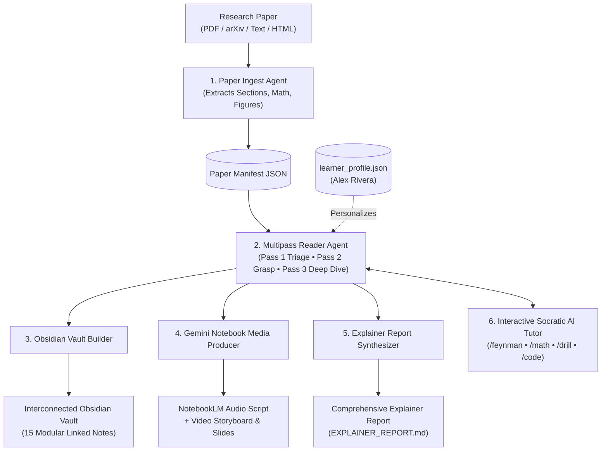
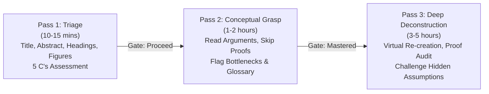

# Research Paper Reading Playbook for the Autonomous Learner

> A personalized, multi-agent AI system that transforms dense academic papers into interconnected Obsidian wiki vaults, NotebookLM-style explainer podcasts, video storyboards, detailed technical reports, and an interactive Socratic AI tutor.

---

## 1. System Vision & Architecture

Reading modern research papers is challenging: notation is dense, background context is implicit, and authors condense critical derivations. For engineers and researchers bridging from applied domains to foundational theory, the cognitive hurdle can be daunting.

The **Paper Reading Playbook** solves this by coupling **Keshav's 3-Pass Methodology** with an autonomous multi-agent pipeline tailored to a **Specific Learner Profile**.



---

## 2. Core Methodological Pillars

### 2.1 The Multipass Reading Framework
Adapted from S. Keshav's canonical paper-reading approach and modernized for deep technical evaluation:



- **Pass 1: Triage & Reconnaissance (10-15 minutes)**:
  - Scans title, abstract, introduction, section headings, figures, and conclusions.
  - Applies the **5 C's**: *Category, Context, Correctness, Contributions, Clarity*.
  - Determines whether to read further, file for later, or discard.
- **Pass 2: Conceptual Grasp & Structural Inspection (1-2 hours)**:
  - Reads through main arguments without getting bogged down in complex lemmas or appendices.
  - Inspects every diagram and benchmark axis.
  - Automatically flags unfamiliar terms matching the learner's `developing` knowledge list.
  - Engages the AI Chatbot tutor for Socratic clarification.
- **Pass 3: Deep Technical Deconstruction & Virtual Walk-Through (3-5 hours)**:
  - Mentally re-implements the paper from first principles.
  - Uncovers hidden assumptions, computational complexity bounds, and non-claims.
  - Reconstructs minimal toy code and verifies formal proof scripts.

---

## 3. Key Capabilities & Generated Deliverables

### 3.1 Interconnected Obsidian Knowledge Vault
Generates an Obsidian vault formatted to the gold-standard topology (as demonstrated in `vp-vnp-vault/`):
- `00 Index.md`: Map of Content (MOC), audience context, and sequential reading path.
- `01 Big picture.md`: Mermaid concept graph and 1-paragraph synthesis.
- `02 Foundations and context.md`: Historical obstacles and why prior art failed.
- `03 Core objects and definitions.md`: Formal definitions and notation tables.
- `04 What the paper claims.md`: Precise theorem statements and claimed bounds.
- `05 Proof architecture.md`: Top-down argument flowchart and bifurcation.
- `06 Primary mechanism - Branch A.md` & `07 Primary mechanism - Branch B.md`: Deep dive into proof branches.
- `08 What the result does not say.md`: Boundaries, caveats, and non-claims.
- `09 Relevance and consequences.md`: Theoretical and engineering implications.
- `10 Formalization and code verification.md`: Minimal Python simulations and proof audits.
- `11 Reception and valid comments.md`: Community scrutiny and review consensus.
- `12 How to evaluate it yourself.md`: Active-recall exercises and self-checks.
- `13 Glossary.md` & `14 References.md`: Alphabetical cross-linked definitions and bibliography.

### 3.2 Gemini Notebook & Multimedia Explainer Pipeline
- **NotebookLM-Style Audio Overview Script (`AUDIO_OVERVIEW_SCRIPT.md`)**: A two-host podcast conversation featuring **Alex** (the skeptical systems engineer) and **Jordan** (the intuitive synthesizer) breaking down the paper with wit, depth, and clarity.
- **Interactive Presentation Deck (`slides.html`)**: HTML5/SVG presentation with presenter notes, math blocks, and visual diagrams.
- **Video Storyboard Frames (`video_frames/`)**: High-resolution visual frames generated automatically for video production.

### 3.3 Publication-Grade Technical Explainer Report (`EXPLAINER_REPORT.md`)
- Executive summary with the core breakthrough distilled into 3 sentences.
- Rigorous mathematical formulations (e.g. Permanent vs Determinant complexity).
- Detailed proof architecture and bifurcation analysis.
- Critical evaluation, failure modes, and reproduction checklist.

### 3.4 Interactive Socratic & Feynman AI Tutor
- Grounded strictly in the paper manifest and generated vault.
- Supports 4 interactive modes:
  - `/feynman`: High-level systems and software architecture analogies.
  - `/math`: Step-by-step mathematical derivations and index expansions.
  - `/drill`: Active-recall questions testing comprehension of assumptions.
  - `/code`: Minimal runnable Python scripts demonstrating the concept.

---

## 4. Persona & Learner Scaffolding

The playbook is personalized via [`learner_profile.json`](file:///d:/sanjay/paper-reading/learner_profile.json):

| Dimension | Profile Configuration (Alex Rivera) |
| :--- | :--- |
| **Role** | Senior AI Systems Engineer & Applied ML Researcher |
| **Strong Areas** | Python, PyTorch, Linear Algebra, Distributed Systems, P vs NP basics |
| **Intermediate** | Information Theory, Reinforcement Learning, Probabilistic Models |
| **Developing** | Algebraic Complexity (VP vs VNP), Differential Geometry, Lean 4 |
| **Analogy Domain** | Distributed systems, caching mechanics, RPC batching, microservices |
| **Math Rule** | Step-by-step index tracking; no hand-waving |
| **Truth Marker** | Strict distinction between `*(paper)*` facts and `*(analogy)*` heuristics |

---

## 5. Agent Skills in `.agents/skills/`

The system provides 6 production-grade agent skills:
1. [`.agents/skills/paper-ingest`](file:///d:/sanjay/paper-reading/.agents/skills/paper-ingest/SKILL.md): Ingests PDF, arXiv, HTML, and text papers into structured JSON.
2. [`.agents/skills/multipass-reader`](file:///d:/sanjay/paper-reading/.agents/skills/multipass-reader/SKILL.md): Orchestrates Pass 1, Pass 2, and Pass 3 reading gates.
3. [`.agents/skills/concept-explainer`](file:///d:/sanjay/paper-reading/.agents/skills/concept-explainer/SKILL.md): AI Chatbot tutor for Socratic and Feynman dialogue.
4. [`.agents/skills/obsidian-vault-builder`](file:///d:/sanjay/paper-reading/.agents/skills/obsidian-vault-builder/SKILL.md): Generates 15-note interconnected Obsidian vaults.
5. [`.agents/skills/gemini-notebook-media`](file:///d:/sanjay/paper-reading/.agents/skills/gemini-notebook-media/SKILL.md): Produces NotebookLM podcast scripts, slides, and video assets.
6. [`.agents/skills/explainer-report-generator`](file:///d:/sanjay/paper-reading/.agents/skills/explainer-report-generator/SKILL.md): Synthesizes comprehensive technical reports.

Detailed system specifications are documented in [`agents.md`](file:///d:/sanjay/paper-reading/agents.md).

---

## 6. Quick Start

To get started right away:
```bash
# 1. Install dependencies
pip install -r requirements.txt

# 2. Run the end-to-end pipeline on any paper
python -m src.cli run-all "vp-vnp-vault/00 Index.md"

# 3. Launch the interactive AI tutor
python -m src.cli chat "vp-vnp-vault/00 Index.md"
```

For detailed instructions, see [`GETTING_STARTED.md`](file:///d:/sanjay/paper-reading/GETTING_STARTED.md).
