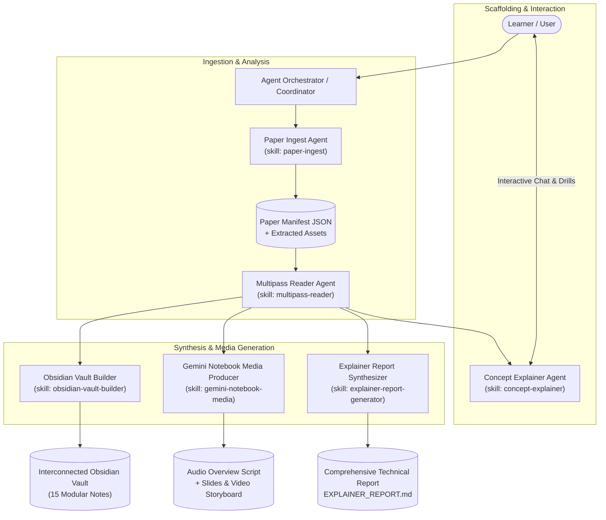
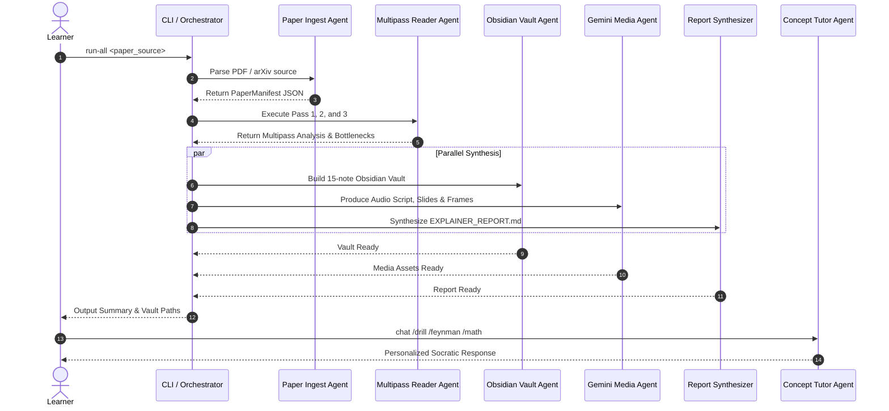

# Multi-Agent Architecture & Agent System Specifications

This document defines the multi-agent architecture powering the **Paper Reading Playbook**. The system operates as an autonomous, orchestrated federation of specialized agents designed to decompose, analyze, explain, and synthesize complex research papers for a specific learner.



---

## 1. Orchestration & Coordination Model

The system employs a **Pipeline & Supervisor Architecture**:
1. **Context Isolation**: Each agent maintains a specialized prompt context and toolset to prevent token bloat and hallucination.
2. **Artifact Passing**: Agents communicate via structured, validated schemas (`PaperManifest`, `PassSummary`, `LearnerProfile`).
3. **Learner Centricity**: All explanatory agents ingest `learner_profile.json` as immutable conditioning to tailor explanation depth, domain analogies, and mathematical scaffolding.

---

## 2. Agent Roster & Detailed Specifications

### 2.1 Agent 1: Paper Ingest Agent (`PaperIngestAgent`)
- **Associated Skill**: `.agents/skills/paper-ingest/SKILL.md`
- **Primary Mission**: Ingest research documents across arbitrary formats (PDF, arXiv, HTML, Markdown, LaTeX) and produce a clean, structured `PaperManifest`.

#### Core Responsibilities
- Parse raw documents using PyMuPDF / PDFPlumber or arXiv APIs.
- Isolate structural sections, hierarchical headings, inline and display equations.
- Extract embedded figures, charts, and tables into `assets/<paper_id>/`.
- Normalize metadata (title, authors, submission date, DOI, venue/review status).

#### Input / Output Schema
- **Input**: Source string (local file path, arXiv URL, or arXiv ID).
- **Output**: Validated `PaperManifest` JSON object.

---

### 2.2 Agent 2: Multipass Reader Agent (`MultipassReaderAgent`)
- **Associated Skill**: `.agents/skills/multipass-reader/SKILL.md`
- **Primary Mission**: Execute S. Keshav's 3-pass methodology tailored to the learner's cognitive profile, managing reading progression gates and bottleneck detection.

#### The 3-Pass Workflow
1. **Pass 1 (Triage & Reconnaissance - 10-15 mins)**:
   - Evaluates the **5 C's**: *Category, Context, Correctness, Contributions, Clarity*.
   - Issues Gate Decision: *Drop/Archive*, *Read Later*, or *Proceed to Pass 2*.
2. **Pass 2 (Conceptual Grasp & Inspection - 1-2 hours)**:
   - Reads through arguments while deferring dense technical proofs and appendices.
   - Detects cognitive bottlenecks matching the learner's `developing` concepts.
   - Generates targeted Socratic questions for the Concept Explainer Agent.
3. **Pass 3 (Deep Technical Deconstruction - 3-5 hours)**:
   - Mentally reconstructs the paper from first principles.
   - Scrutinizes assumptions, uncovers hidden edge cases, and audits formal proofs.
   - Identifies non-claims (what the paper deliberately does *not* prove).

---

### 2.3 Agent 3: Concept Explainer & Tutor Agent (`ConceptTutorAgent`)
- **Associated Skill**: `.agents/skills/concept-explainer/SKILL.md`
- **Primary Mission**: Serve as an interactive, personalized 1-on-1 research mentor and tutor for the learner.

#### Four Pedagogical Modes
1. **Feynman Analogy Mode (`/feynman`)**:
   - Bridges complex theoretical constructs to familiar engineering concepts (e.g. distributed systems, cache mechanics, modular software patterns).
   - Enforces strict labeling: `*(paper)*` for empirical/proven facts vs `*(analogy)*` for pedagogical heuristics.
2. **Mathematical Scaffolding Mode (`/math`)**:
   - Unpacks tensor notations, index summations, and formal proofs step-by-step.
   - Explicitly defines the dimension, domain, and codomain of every symbol.
3. **Socratic Active-Recall Mode (`/drill`)**:
   - Challenges the learner with edge cases, parameter changes, and counterfactual questions to verify mental models.
4. **Code & Toy Implementation Mode (`/code`)**:
   - Translates abstract theorems or pipeline descriptions into minimal, runnable Python snippets.

---

### 2.4 Agent 4: Obsidian Vault Architect Agent (`ObsidianArchitectAgent`)
- **Associated Skill**: `.agents/skills/obsidian-vault-builder/SKILL.md`
- **Primary Mission**: Transform the ingested paper and multipass analysis into a production-grade, modular, hyperlinked Obsidian knowledge vault.

#### Standard 15-Note Vault Blueprint
```
<vault_name>/
├── 00 Index.md                                   # Map of Content (MOC), audience, reading path
├── 01 Big picture.md                             # Mermaid overview diagram, 1-paragraph summary
├── 02 Foundations and context.md                 # Background, prior art, why standard methods hit barriers
├── 03 Core objects and definitions.md            # Formal notation, mathematical objects, spaces
├── 04 What the paper claims.md                   # Precise theorems, claimed bounds, exact statements
├── 05 Proof architecture.md                     # Top-down map of the main argument/pipeline
├── 06 Primary mechanism - Branch A.md            # Detailed technical breakdown of branch 1
├── 07 Primary mechanism - Branch B.md            # Detailed technical breakdown of branch 2
├── 08 What the result does not say.md            # Caveats, non-claims, boundaries, open questions
├── 09 Relevance and consequences.md              # Broader implications, applications, theoretical impact
├── 10 Formalization and code verification.md    # Code reproduction and formal proof verification
├── 11 Reception and valid comments.md            # Community reactions, peer reviews, critique
├── 12 How to evaluate it yourself.md             # Active recall checks, verification steps, homework
├── 13 Glossary.md                                # Alphabetical definitions with cross-linked wikilinks
└── 14 References.md                              # Key citations with context and outbound links
```

---

### 2.5 Agent 5: Gemini Notebook & Media Producer Agent (`GeminiMediaProducerAgent`)
- **Associated Skill**: `.agents/skills/gemini-notebook-media/SKILL.md`
- **Primary Mission**: Generate multimodal learning artifacts modeled after Google NotebookLM and Gemini Audio/Video pipelines.

#### Output Deliverables
1. **Two-Host Deep-Dive Audio Podcast Script (`AUDIO_OVERVIEW_SCRIPT.md`)**:
   - Dynamic dialogue between **Alex** (analytical, systems-minded engineer) and **Jordan** (intuitive conceptual synthesizer).
   - Explores motivation, breakthrough intuition, mathematical nuance, and unverified caveats with high energy and conversational flow.
2. **Interactive Explainer Slides (`slides.html`)**:
   - Clean, modern presentation deck featuring core formulas, comparisons, and boundary warnings.
3. **Visual Storyboard & Frame Renderer (`video_frames/`)**:
   - High-resolution SVG/PNG slide frames generated via Matplotlib and Pillow for automated video compilation.

---

### 2.6 Agent 6: Explainer Report Synthesizer Agent (`ExplainerReportAgent`)
- **Associated Skill**: `.agents/skills/explainer-report-generator/SKILL.md`
- **Primary Mission**: Produce an exhaustive, publication-grade Technical Explainer Report (`EXPLAINER_REPORT.md`).

#### Report Structure
1. Executive Summary & Core Breakthrough in 3 Sentences.
2. Historical Context & The Relativization/Natural Proof Barriers.
3. Mathematical Formulation (e.g. Permanent vs Determinant).
4. Proof Architecture & Bifurcation Analysis (Mermaid Flowcharts).
5. Critical Vulnerabilities & Verification Checklist (Lean 4 code audit, unverified preprint status).
6. Actionable Takeaways for the Specific Learner.

---

## 3. Data Flow & Communication Protocols



---

## 4. Grounding, Safety & Hallucination Guardrails

1. **Source Citation Requirement**: All mathematical and conceptual assertions must link back to specific sections or equations from the paper manifest.
2. **Fact vs Analogy Separation**: Any simplification or engineering heuristic must be explicitly flagged with `*(analogy)*` to prevent confusing mental models with the paper's literal claims.
3. **Preprint / Verification Warning**: If a paper's proof is unverified by peer review or formal math community consensus, agents must prominently display a disclaimer across all generated artifacts.
