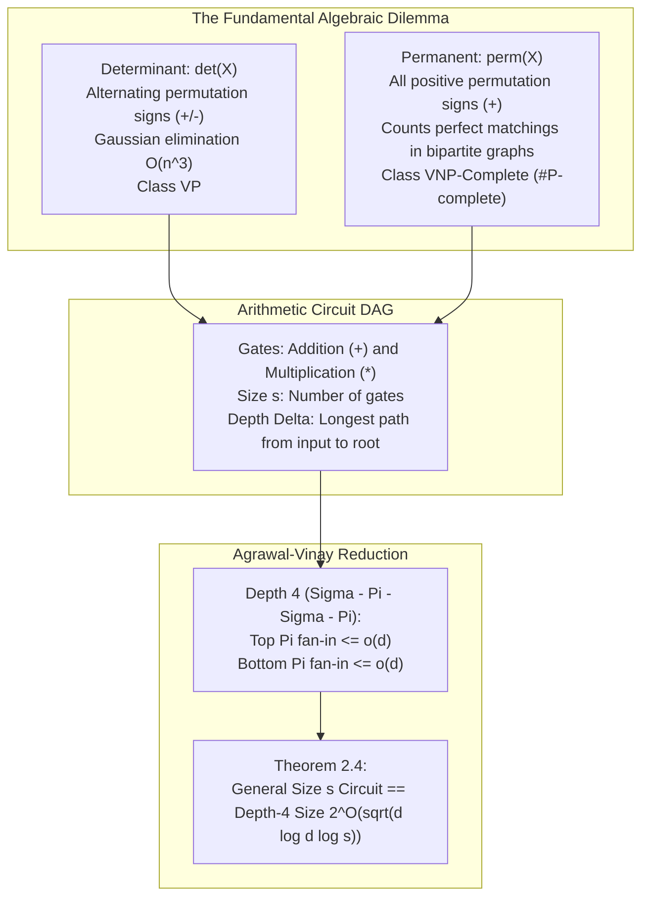

# Technical Explainer Report: Arithmetic Circuits — A Chasm at Depth Four

| Metadata | Details |
| :--- | :--- |
| **Paper Title** | *Arithmetic Circuits: A Chasm at Depth Four* |
| **Authors** | Manindra Agrawal (IIT Kanpur) & V. Vinay (CMI & Geodesic Information Systems) |
| **Venue / Record** | Electronic Colloquium on Computational Complexity (ECCC TR08-062, 2008); IEEE FOCS 2008 |
| **Target Audience** | Recent Graduates in Computer Science, Mathematics, or Electrical Engineering |
| **Primary Breakthrough** | Establishing that exponential lower bounds for depth-4 arithmetic circuits imply exponential lower bounds for unrestricted-depth circuits, collapsing the $\mathrm{VP} \neq \mathrm{VNP}$ quest to depth 4. |

---

## 1. Executive Summary
In computational complexity theory, determining whether Leslie Valiant's algebraic conjecture $\mathrm{VP} \neq \mathrm{VNP}$ holds has stood open since 1979. This paper proves a structural depth-reduction theorem: any polynomial of degree $d = O(n)$ computable by an arithmetic circuit of size $2^{o(d + d \log(n/d))}$ can also be computed by a **depth-four ($\Sigma\Pi\Sigma\Pi$) arithmetic circuit** of size $2^{o(d + d \log(n/d))}$.

### Three Core Takeaways:
1. **The Chasm at Depth Four**: Additional circuit depth beyond 4 does not help for exponential-sized circuits. Proving lower bounds against $\Sigma\Pi\Sigma\Pi$ circuits is equivalent to proving lower bounds for general circuits.
2. **Determinant Complexity Collapse**: While the determinant requires exponential size at depth 3 over finite fields, it collapses to subexponential size $n^{O(\sqrt{n})}$ at depth 4.
3. **PIT Derandomization**: Black-box derandomization of Polynomial Identity Testing for restricted depth-4 circuits yields a deterministic quasi-polynomial time ($n^{O(\log n)}$) algorithm for general low-degree PIT.

---

## 2. Foundational Primer for Recent Graduates

### 2.1 What is the Determinant?
Given an $n \times n$ matrix $X = (x_{ij})$:
$$\det(X) = \sum_{\sigma \in S_n} \operatorname{sgn}(\sigma) \prod_{i=1}^n x_{i, \sigma(i)}$$
- **Geometric Meaning**: Oriented volume scaling factor of the linear transformation.
- **Why it's in VP**: The alternating sign $\operatorname{sgn}(\sigma)$ ensures that elementary row operations (adding a multiple of one row to another) preserve the determinant, enabling Gaussian elimination in $O(n^3)$ operations. Mahajan & Vinay (1997) proved it can also be computed division-free in $O(n^4)$ time using clow sequences.

### 2.2 What is the Permanent?
$$\operatorname{perm}(X) = \sum_{\sigma \in S_n} \prod_{i=1}^n x_{i, \sigma(i)}$$
- **Combinatorial Meaning**: Counts perfect matchings in a bipartite graph.
- **Why it's in VNP-complete**: Without sign cancellations, row operations fail. Valiant showed that computing the permanent is $\#P$-complete.

---

## 3. Mathematical Proof Architecture

The transformation proceeds in four distinct phases:
1. **VSBR Depth Reduction**: The input circuit $C$ of size $M$ and degree $d$ is converted into an $O(\log d)$-depth circuit with multiplication fan-in 2.
2. **Structural Balancing (Circuit $D$)**: Using partial proof tree derivatives $[g, h]$, the circuit is refactored so that multiplication fan-in is $\le 6$, and crucially, **every child of a multiplication gate has at most half the degree of the parent gate**:
   $$\deg(\text{child}) \le \frac{1}{2} \deg(\text{parent})$$
3. **Bisecting the Circuit**: Circuit $D$ is split at level $t = \frac{1}{2} \log_6 \ell$:
   - Top component $P_0(y_1, \dots, y_k)$: has $t$ multiplication layers, degree $\le 6^t = \sqrt{\ell}$.
   - Bottom components $P_1, \dots, P_k$: degree bounded by $\frac{d}{2^t} = \frac{d}{\ell^\delta}$.
4. **Sum-of-Products Assembly (Circuit $E$)**: Expanding $P_0$ and each $P_i$ into depth-2 forms yields a 4-layer $\Sigma\Pi\Sigma\Pi$ circuit of total size:
   $$2^{O(\sqrt{(d + d \log(n/d)) \log S})} + S \cdot 2^{o(d + d \log(n/d))} = 2^{o(d + d \log(n/d))}$$

---

## 4. Black-Box PIT Derandomization

1. An optimal pseudorandom generator against depth-4 circuits produces a hard multilinear polynomial family $\{q_m\}$ requiring $2^{\Omega(m)}$ size depth-4 circuits.
2. By Theorem 2.4, $\{q_m\}$ must require exponential size on **unrestricted-depth** circuits.
3. Using the Nisan-Wigderson combinatorial generator combined with Kaltofen's multivariate polynomial factorization, this hardness is converted into a deterministic identity test running in $n^{O(\log n)}$ time.

---

## 5. Critical Boundaries & Non-Claims
- **Does not prove VP != VNP**: It proves the equivalence between depth-4 lower bounds and general lower bounds.
- **Does not give efficient permanent algorithms**: The permanent is still believed to require exponential size.
- **Quasi-polynomial PIT**: The derandomization achieves $n^{O(\log n)}$, leaving full polynomial time $n^{O(1)}$ open.

---

## 6. Actionable Takeaways for Researchers
- When proving circuit lower bounds, focus all analytical machinery (such as shifted partial derivatives) directly on depth-4 circuits.
- Explore the companion 15-note Obsidian vault in `vaults/17_agrawal_vinay_chasm_depth_four-vault/` and the interactive Python code.
