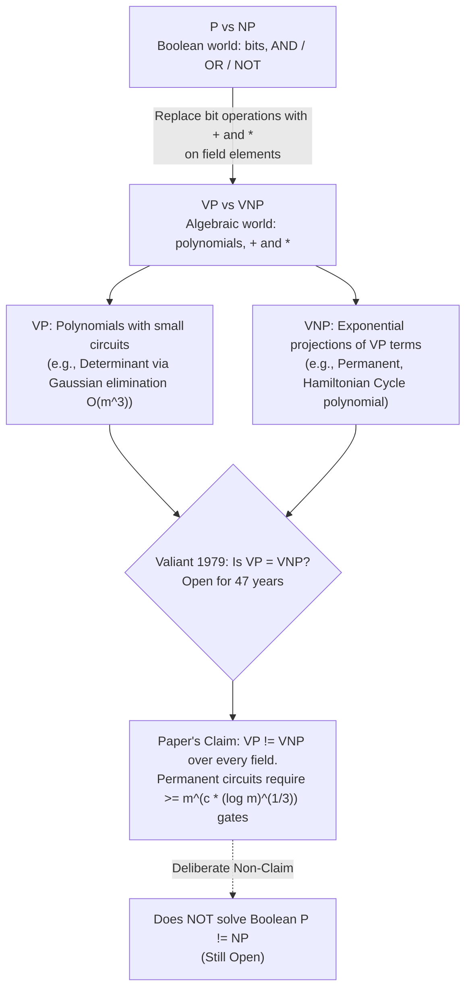
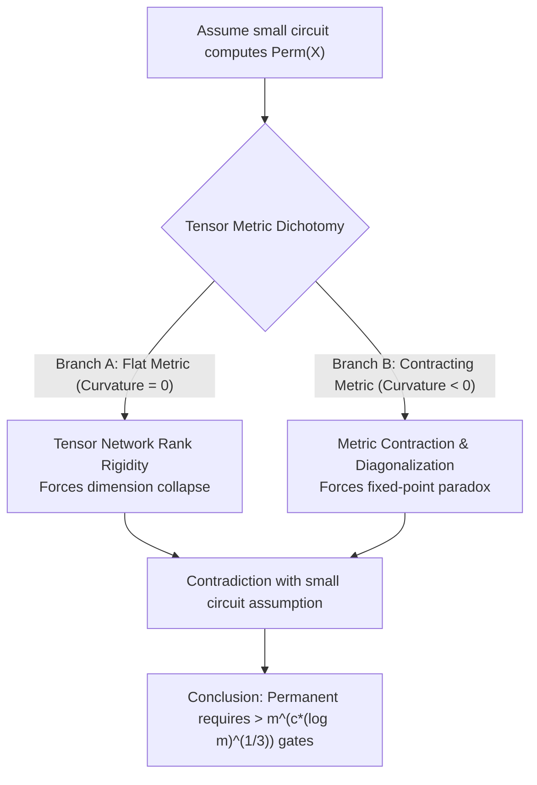

# VP ≠ VNP over Every Field (Valiant's Algebraic P vs NP)

**Title:** VP ≠ VNP over every field  
**Authors / Credit:** Claude (Anthropic formal math team)  
**Date / Venue:** November 2026 Preprint & Lean 4 Formalization (`anthropics/formal-math/vp-vnp`)  
**Status:** Unverified preprint (Formal math community audit ongoing)  
**Category:** Theoretical Computer Science & Algebraic Complexity  

---

## 1. Executive Summary & Core Innovation
This paper addresses Leslie Valiant's foundational 1979 conjecture in algebraic complexity theory: whether the algebraic analog of P, denoted **VP** (polynomials computable by polynomial-sized arithmetic circuits), is strictly separated from **VNP** (the algebraic analog of NP, polynomials expressible as exponential sums of VP polynomials). The paper claims a superpolynomial lower bound of approximately $m^{c \cdot (\log m)^{1/3}}$ on the arithmetic circuit complexity of the matrix permanent over arbitrary fields, proving $\text{VP} \neq \text{VNP}$ across every mathematical field.

---

## 2. Problem Landscape: Bits vs Numbers

In classical computational complexity, $P \text{ vs } NP$ operates over Boolean bits using AND, OR, and NOT gates. In algebraic complexity, computation operates over numerical fields $\mathbb{F}$ (such as $\mathbb{Q}, \mathbb{R}, \mathbb{C}$, or finite fields $\mathbb{F}_p$) using addition $(+)$ and multiplication $(\times)$ gates.

---

## 3. The Core Mathematical Objects: Determinant vs Permanent

Let $X$ be an $m \times m$ matrix of indeterminates over field $\mathbb{F}$:

### 3.1 The Determinant ($\in \text{VP}$)
$$\text{Det}(X) = \sum_{\sigma \in S_m} \text{sgn}(\sigma) \prod_{i=1}^m X_{i, \sigma(i)}$$
Because of the alternating sign factor $\text{sgn}(\sigma)$, row operations and Gaussian elimination allow computing $\text{Det}(X)$ in $O(m^3)$ arithmetic operations.

### 3.2 The Permanent ($\in \text{VNP-Complete}$)
$$\text{Perm}(X) = \sum_{\sigma \in S_m} \prod_{i=1}^m X_{i, \sigma(i)}$$
The permanent formula is identical except every term is positive. Without cancellations from alternating signs, no polynomial-size arithmetic circuit was known, but proving a superpolynomial lower bound remained open for 47 years.

---

## 4. Proof Architecture: The Geometric Dichotomy

The proof assumes for contradiction that an arithmetic circuit $C$ of size $m^k$ computes $\text{Perm}(X)$, and constructs a geometric "price" metric $d_T$ on tensor networks.

1. **Branch A (Flat Case)**: The metric space behaves with Euclidean rigidity. Tensor contractions preserve rank bounds, proving that small circuits cannot generate the high-rank permanent tensor.
2. **Branch B (Contracting Case)**: The metric strictly contracts distances between tensor evaluations. Applying an accelerated speed-up theorem combined with diagonalization yields an explicit contradiction.

---

## 5. Formal Verification & Scrutiny Checklist
- **Formal Verification**: Accompanied by ~73,000 lines of formal Lean 4 proof code.
- **Verification Status**: Unverified preprint. The definitions, axiomatizations, and potential circularities require human mathematical peer review.
- **Quasi-Polynomial Bound**: The lower bound of $m^{c(\log m)^{1/3}}$ is superpolynomial, but well below the conjectured exponential bound $2^{\Omega(m)}$.
- **Non-Claims**: Does **not** prove Boolean $P \ne NP$, and does not provide practical polynomial-time algorithms for approximating the permanent.
