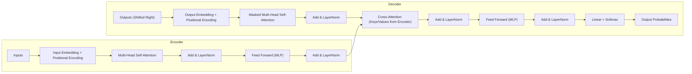

# Attention Is All You Need

**Authors:** Ashish Vaswani, Noam Shazeer, Niki Parmar, Jakob Uszkoreit, Llion Jones, Aidan N. Gomez, Lukasz Kaiser, Illia Polosukhin  
**Venue / Year:** NeurIPS 2017  
**arXiv:** [1706.03762](https://arxiv.org/abs/1706.03762)  
**Category:** Neural Architecture & Self-Attention

---

## 1. Abstract
The dominant sequence transduction models are based on complex recurrent or convolutional neural networks that include an encoder and a decoder. The best performing models also connect the encoder and decoder through an attention mechanism. We propose a new simple network architecture, the **Transformer**, based solely on attention mechanisms, dispensing with recurrence and convolutions entirely. Experiments on two machine translation tasks show these models to be superior in quality while being more parallelizable and requiring significantly less time to train. Our model achieves 28.4 BLEU on the WMT 2014 English-to-German translation task, improving over the existing best results, including ensembles, by over 2 BLEU. On the WMT 2014 English-to-French translation task, our model establishes a new single-model state-of-the-art BLEU score of 41.8 after training for 3.5 days on eight GPUs.

---

## 2. Core Problem Before This Paper
Prior to this work, sequential modeling was monopolized by Recurrent Neural Networks (RNNs, LSTMs, GRUs):
1. **Sequential Computation Bottleneck**: RNNs compute hidden states sequentially ($h_t = f(h_{t-1}, x_t)$), preventing parallelization across training tokens.
2. **Vanishing/Exploding Gradients on Long Sequences**: Information had to travel linearly across steps, causing catastrophic forgetting over long context windows despite gating mechanisms.
3. **High Path Length Between Distant Tokens**: The number of operations to connect signals from two arbitrary input positions grew as $O(n)$ in RNNs and $O(\log_k(n))$ in dilated ConvNets (ByteNet, WaveNet).

The Transformer achieves $O(1)$ sequential operations and an $O(1)$ path length between any pair of tokens.

---

## 3. Mathematical Formulation

### 3.1 Scaled Dot-Product Attention
Given queries $Q \in \mathbb{R}^{n \times d_k}$, keys $K \in \mathbb{R}^{m \times d_k}$, and values $V \in \mathbb{R}^{m \times d_v}$:

$$\text{Attention}(Q, K, V) = \text{softmax}\left(\frac{QK^T}{\sqrt{d_k}}\right)V$$

The scaling factor $\frac{1}{\sqrt{d_k}}$ is essential: for large $d_k$, the dot products grow large in magnitude, pushing the softmax function into regions with extremely small gradients.

### 3.2 Multi-Head Attention
Instead of performing a single attention function, Multi-Head Attention projects $Q, K, V$ linearly $h$ times with learned parameter matrices $W_i^Q, W_i^K, W_i^V$:

$$\text{MultiHead}(Q, K, V) = \text{Concat}(\text{head}_1, \dots, \text{head}_h)W^O$$

$$\text{where} \quad \text{head}_i = \text{Attention}(Q W_i^Q, K W_i^K, V W_i^V)$$

### 3.3 Positional Encoding
Because the self-attention mechanism contains no recurrence and no convolution, it is permutation-equivariant. The authors inject absolute positional signals using sinusoidal frequencies:

$$PE_{(pos, 2i)} = \sin\left(\frac{pos}{10000^{2i / d_{\text{model}}}}\right)$$

$$PE_{(pos, 2i+1)} = \cos\left(\frac{pos}{10000^{2i / d_{\text{model}}}}\right)$$

---

## 4. Architecture Blueprint

---

## 5. Key Empirical Breakthroughs
- **Training Speed**: The base model trained in 12 hours on 8 P100 GPUs; the big model trained in 3.5 days.
- **BLEU Score**: Established a new SOTA of 28.4 on WMT'14 En-De and 41.8 on WMT'14 En-Fr.
- **Universal Applicability**: Laid the architectural foundation for subsequent language models (GPT, BERT, T5) and vision models (ViT).

---

## 6. Critical Caveats & Non-Claims
- **Quadratic Memory Complexity**: Attention matrix computation scales as $O(n^2)$ with sequence length $n$, making raw Transformers memory-intensive for long sequences without FlashAttention.
- **Absence of Inductive Bias**: Unlike CNNs (spatial locality/translation invariance) or RNNs (temporal ordering), Transformers require substantial pre-training data to discover structural relationships.
