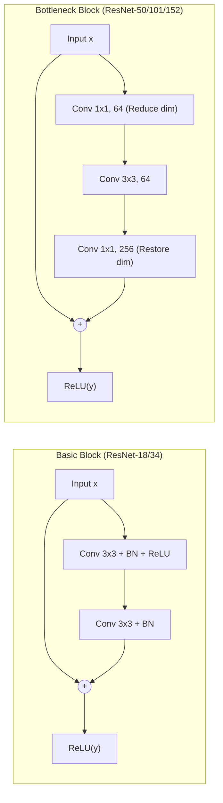

# Deep Residual Learning for Image Recognition (ResNet)

**Authors:** Kaiming He, Xiangyu Zhang, Shaoqing Ren, Jian Sun  
**Venue / Year:** CVPR 2016 (Best Paper Award)  
**arXiv:** [1512.03385](https://arxiv.org/abs/1512.03385)  
**Category:** Deep Learning Architecture & Optimization

---

## 1. Abstract
Deeper neural networks are more difficult to train. We present a residual learning framework to ease the training of networks that are substantially deeper than those used previously. We explicitly reformulate the layers as learning residual functions with reference to the layer inputs, instead of learning unreferenced functions. We provide comprehensive empirical evidence showing that these residual networks are easier to optimize, and can gain accuracy from considerably increased depth. On the ImageNet dataset we evaluate residual nets with a depth of up to 152 layers—8x deeper than VGG nets but still having lower complexity. An ensemble of these residual nets achieves 3.57% error on the ImageNet test set. This result won the 1st place on the ILSVRC 2015 classification task. We also present analysis on CIFAR-10 with 100 and 1000 layers.

---

## 2. The Degradation Problem
Before ResNet, researchers observed a paradox: as network depth increased, accuracy saturated and then rapidly degraded.
- This was **not** caused by overfitting: the training error *also* increased with depth (a 56-layer plain network performed worse than a 20-layer plain network on both training and test sets).
- Vanishing/exploding gradients were largely mitigated by Batch Normalization and normalized initialization, yet deep plain networks remained fundamentally difficult for SGD to optimize toward identity mappings.

---

## 3. Mathematical Formulation

### 3.1 Residual Formulation
Let $\mathcal{H}(x)$ be the underlying mapping to be fit by a few stacked layers, where $x$ is the input. Rather than hypothesizing that multiple nonlinear layers directly approximate $\mathcal{H}(x)$, ResNet reformulates the layers to approximate a residual mapping:

$$\mathcal{F}(x) := \mathcal{H}(x) - x$$

The original function becomes:

$$\mathcal{H}(x) = \mathcal{F}(x) + x$$

$$y = \mathcal{F}(x, \{W_i\}) + x$$

If an identity mapping were optimal, optimizers can simply drive the weights of $\mathcal{F}(x)$ toward zero, which is dramatically easier than training stacked non-linear layers to synthesize an identity operator from scratch.

### 3.2 Gradient Flow
During backpropagation with loss $\mathcal{E}$:

$$\frac{\partial \mathcal{E}}{\partial x} = \frac{\partial \mathcal{E}}{\partial y} \frac{\partial y}{\partial x} = \frac{\partial \mathcal{E}}{\partial y} \left(\frac{\partial \mathcal{F}}{\partial x} + I\right)$$

The $+ I$ term acts as an uninterrupted gradient highway: gradients propagate directly from deep layers back to shallow layers without being repeatedly attenuated by matrix multiplications.

---

## 4. Architecture & Bottleneck Design

---

## 5. Key Results
- **ImageNet 2015 Winner**: Achieved 3.57% top-5 test error, surpassing human-level performance (typically quoted around 5.1%).
- **Swept ILSVRC & COCO 2015**: Won 1st place in ImageNet Classification, ImageNet Detection, ImageNet Localization, COCO Detection, and COCO Segmentation.
- **Scaled to 1000 Layers**: Successfully trained a 1000-layer network on CIFAR-10 with zero optimization failure.
