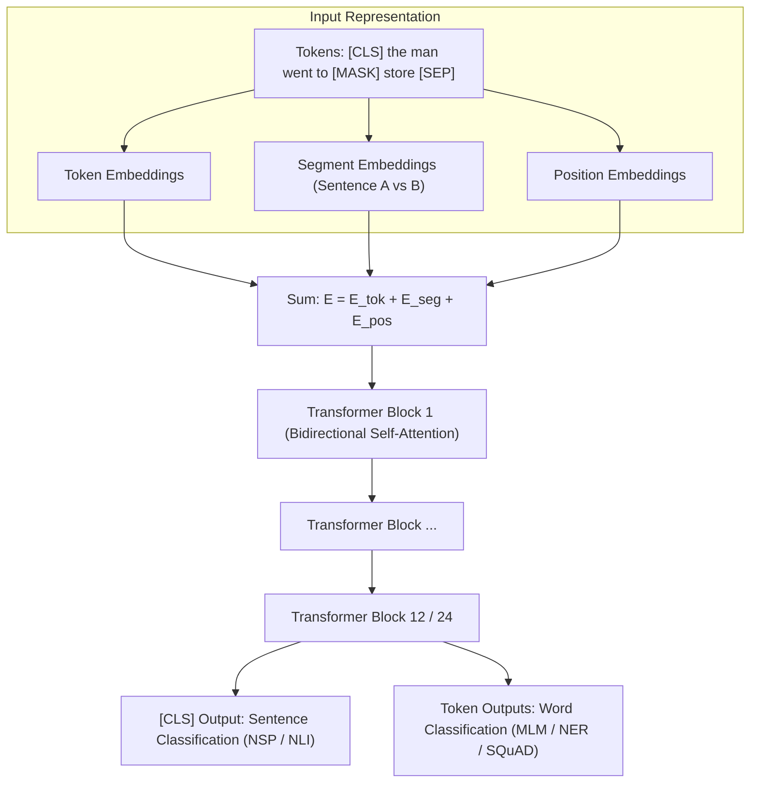

# BERT: Pre-training of Deep Bidirectional Transformers for Language Understanding

**Authors:** Jacob Devlin, Ming-Wei Chang, Kenton Lee, Kristina Toutanova  
**Venue / Year:** NAACL-HLT 2019 (Best Long Paper Award)  
**arXiv:** [1810.04805](https://arxiv.org/abs/1810.04805)  
**Category:** Pre-training & Natural Language Representations

---

## 1. Abstract
We introduce a new language representation model called **BERT**, which stands for **Bidirectional Encoder Representations from Transformers**. Unlike recent language representation models, BERT is designed to pre-train deep bidirectional representations from unlabeled text by jointly conditioning on both left and right context in all layers. As a result, the pre-trained BERT model can be fine-tuned with just one additional output layer to create state-of-the-art models for a wide range of tasks, such as question answering and language inference, without substantial task-specific architecture modifications. BERT is conceptually simple and empirically powerful. It obtains new state-of-the-art results on eleven natural language processing tasks, including pushing the GLUE score to 80.5% (7.7% point absolute improvement), MultiNLI accuracy to 86.7% (4.6% absolute improvement), SQuAD v1.1 question answering Test F1 to 93.2 (1.5 point absolute improvement) and SQuAD v2.0 Test F1 to 83.1 (5.1 point absolute improvement).

---

## 2. Motivation: The Unidirectional Limitation
Prior to BERT, standard language models (like OpenAI GPT-1) were trained left-to-right:

$$P(w_1, \dots, w_n) = \prod_{i=1}^n P(w_i \mid w_1, \dots, w_{i-1})$$

While left-to-right conditioning is ideal for autoregressive text generation, it severely cripples sentence-level and token-level understanding tasks (like SQuAD or NER) where seeing both left and right context simultaneously is vital.

---

## 3. Pre-training Objectives

### 3.1 Masked Language Model (MLM)
To train deep bidirectional representations without allowing words to trivially "see themselves" across stacked attention layers, BERT masks 15% of the input tokens at random:
- 80% of the time: replaced with the `[MASK]` token.
- 10% of the time: replaced with a random word.
- 10% of the time: kept unchanged.

The objective maximizes the log probability of recovering the original masked tokens:

$$\mathcal{L}_{\text{MLM}}(\theta) = -\sum_{i \in M} \log P(x_i \mid \tilde{X}; \theta)$$

### 3.2 Next Sentence Prediction (NSP)
To capture sentence-pair relationships (crucial for QA and NLI):
- Input: `[CLS] Sentence A [SEP] Sentence B [SEP]`
- 50% of the time: Sentence B is the actual next sentence (`IsNext`).
- 50% of the time: Sentence B is a random sentence from the corpus (`NotNext`).

---

## 4. Architectural Overview

---

## 5. Landmark Impact
- Unified 11 distinct NLP tasks under a single pre-trained encoder architecture with lightweight task heads.
- Sparked the modern pre-train + fine-tune wave across academia and enterprise NLP pipelines (RoBERTa, ALBERT, DeBERTa, ELECTRA).
