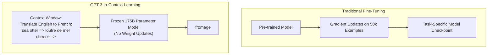

# Language Models are Few-Shot Learners (GPT-3)

**Authors:** Tom B. Brown, Benjamin Mann, Nick Ryder, Melanie Subbiah, Jared Kaplan, Prafulla Dhariwal, Arvind Neelakantan, Pranav Shyam, Girish Sastry, Amanda Askell, Sandhini Agarwal, Ariel Herbert-Voss, Gretchen Krueger, Tom Henighan, Rewon Child, Aditya Ramesh, Daniel M. Ziegler, Jeffrey Wu, Clemens Winter, Christopher Hesse, Mark Chen, Eric Sigler, Mateusz Litwin, Scott Gray, Benjamin Chess, Jack Clark, Christopher Berner, Sam McCandlish, Alec Radford, Ilya Sutskever, Dario Amodei  
**Venue / Year:** NeurIPS 2020  
**arXiv:** [2005.14165](https://arxiv.org/abs/2005.14165)  
**Category:** Foundation Large Language Models & In-Context Learning

---

## 1. Abstract
Recent work has demonstrated substantial gains on many NLP tasks and benchmarks by pre-training on a large corpus of text followed by fine-tuning on a specific task. While typically task-agnostic in architecture, this method still requires task-specific fine-tuning datasets of thousands or tens of thousands of examples. By contrast, humans can generally perform a new language task from only a few examples or from simple instructions. Here we show that scaling up language models greatly improves task-agnostic, few-shot performance, sometimes even reaching competitiveness with prior state-of-the-art fine-tuning approaches. Specifically, we train **GPT-3**, an autoregressive language model with **175 billion parameters**, 10x more than any previous non-sparse language model, and test its performance in the few-shot setting. For all tasks, GPT-3 is applied without any gradient updates or fine-tuning, with tasks and few-shot demonstrations specified purely via text interaction with the model.

---

## 2. Paradigm Shift: In-Context Learning
Before GPT-3, standard practice was:
$$\text{Pre-train on Web Data} \longrightarrow \text{Fine-tune weights on labeled dataset with SGD}$$

GPT-3 eliminated the fine-tuning step:
$$\text{Task Description} + K\text{ Demonstrations} + \text{Query} \longrightarrow \text{Direct Completion via Forward Pass}$$

---

## 3. Model Architecture & Model Family Scalability
GPT-3 uses the same autoregressive transformer architecture as GPT-2 with alternating dense and locally banded sparse attention patterns:

| Model Variant | Parameters | Layers ($n_{\text{layers}}$) | Hidden Dim ($d_{\text{model}}$) | Heads ($n_{\text{heads}}$) | Batch Size (Tokens) |
| :--- | :--- | :--- | :--- | :--- | :--- |
| GPT-3 Small | 125M | 12 | 768 | 12 | 0.5M |
| GPT-3 Medium | 350M | 24 | 1024 | 16 | 0.5M |
| GPT-3 XL | 1.3B | 24 | 2048 | 24 | 1.0M |
| GPT-3 6.7B | 6.7B | 32 | 4096 | 32 | 2.0M |
| GPT-3 13B | 13B | 40 | 5140 | 40 | 2.0M |
| **GPT-3 175B** | **175B** | **96** | **12288** | **96** | **3.2M** |

---

## 4. Core Findings & Breakthrough Behaviors
1. **Power-Law In-Context Scaling**: Few-shot performance scales steadily with parameter count, showing smooth power-law gains.
2. **Emergent Capabilities**: Zero-shot arithmetic, synthetic word scrambling, code generation, and translation without explicitly being trained for those specific tasks.
3. **Limitation Discovery**: Susceptibility to hallucinations, prompt sensitivity, lack of genuine causal reasoning, and repetition loops.
