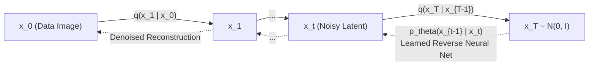

# Denoising Diffusion Probabilistic Models (DDPM)

**Authors:** Jonathan Ho, Ajay Jain, Pieter Abbeel  
**Venue / Year:** NeurIPS 2020  
**arXiv:** [2006.11239](https://arxiv.org/abs/2006.11239)  
**Category:** Generative Modeling & Diffusion

---

## 1. Abstract
We present high quality image synthesis results using diffusion probabilistic models, a class of latent variable models inspired by considerations from nonequilibrium thermodynamics. Our best results are obtained by training on a weighted variational bound designed according to a novel connection between diffusion models and denoising score matching with Langevin dynamics, and our models admit a progressive lossy decompression scheme that can be interpreted as a generalization of autoregressive decoding. On the unconditional CIFAR-10 dataset, we obtain an Inception Score of 9.46 and a state-of-the-art FID score of 3.17. On 256x256 LSUN, we obtain sample quality similar to ProgressiveGAN.

---

## 2. Forward & Reverse Diffusion Processes

Diffusion models define a forward process that gradually corrupts data $x_0$ with Gaussian noise over $T$ timesteps, and learn a reverse neural network process that denoises pure Gaussian noise back into data.

### 2.1 The Forward Process (Fixed Gaussian Kernel)
$$q(x_t \mid x_{t-1}) = \mathcal{N}(x_t; \sqrt{1 - \beta_t} x_{t-1}, \beta_t I)$$

A crucial mathematical property allows direct sampling of $x_t$ at any arbitrary timestep $t$ in closed form without iterating through intermediate steps:

$$x_t = \sqrt{\bar{\alpha}_t} x_0 + \sqrt{1 - \bar{\alpha}_t} \epsilon, \quad \epsilon \sim \mathcal{N}(0, I)$$

where $\alpha_t = 1 - \beta_t$ and $\bar{\alpha}_t = \prod_{s=1}^t \alpha_s$.

### 2.2 The Simplified Training Objective
By parameterizing the neural network $\epsilon_\theta(x_t, t)$ to predict the added noise vector $\epsilon$ rather than the mean $\mu$, the variational lower bound reduces to a Mean Squared Error:

$$L_{\text{simple}}(\theta) = \mathbb{E}_{t, x_0, \epsilon}\left[\|\epsilon - \epsilon_\theta(\sqrt{\bar{\alpha}_t} x_0 + \sqrt{1 - \bar{\alpha}_t} \epsilon, t)\|^2\right]$$

---

## 3. Why DDPM Changed Modern Generative AI
1. **Training Stability**: Unlike Generative Adversarial Networks (GANs), diffusion models optimize a stationary regression loss with no adversarial minimax instability or mode collapse.
2. **High Sample Quality & Diversity**: Beat GANs in Frechet Inception Distance (FID) while preserving the full coverage of the data distribution.
3. **Foundation for Latent Diffusion**: Directly led to Latent Diffusion Models (LDM / Stable Diffusion) and video generators (Sora, Imagen Video).
