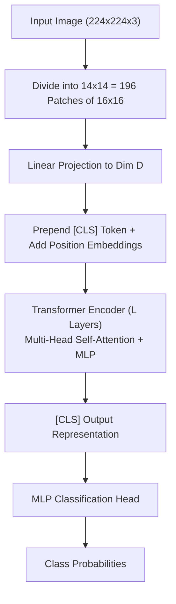

# Vision Transformer (ViT): An Image is Worth 16x16 Words

**Title:** An Image is Worth 16x16 Words: Transformers for Image Recognition at Scale  
**Authors:** Alexey Dosovitskiy et al. (Google Research, Brain Team)  
**Venue / Year:** ICLR 2021  
**arXiv:** [2010.11929](https://arxiv.org/abs/2010.11929)  
**Category:** Vision & Multimodal Architecture  

---

## 1. Executive Summary & Core Innovation
The Vision Transformer demonstrated that the standard Transformer architecture, originally designed for sequential text, can be directly adapted to computer vision with minimal modifications. By treating non-overlapping image patches as tokens and projecting them linearly, ViT eliminates the need for convolutional inductive biases (such as translation equivariance and local receptive fields) when pre-trained on massive datasets (JFT-300M, ImageNet-21k).

---

## 2. Problem Landscape: The Convolutional Monopoly
For nearly a decade following AlexNet (2012), Convolutional Neural Networks (CNNs) were the undisputed foundation of computer vision. CNNs embed strong inductive biases:
- **Local Receptive Fields**: Nearby pixels are assumed to be correlated.
- **Translation Invariance / Equivariance**: Visual features operate identically across different spatial locations.

While these inductive priors help CNNs train efficiently on smaller datasets, they act as an architectural ceiling when training on hundreds of millions of images. ViT trades inductive bias for model capacity and global self-attention.

---

## 3. Mathematical Formulation

### 3.1 Patch Extraction & Linear Projection
Given a 2D image $x \in \mathbb{R}^{H \times W \times C}$ and patch resolution $P \times P$ (e.g., $16 \times 16$):
1. The image is reshaped into a sequence of flattened patches $x_p \in \mathbb{R}^{N \times (P^2 \cdot C)}$, where the total number of patches is:
   $$N = \frac{HW}{P^2}$$
2. Each patch is mapped to latent vector dimension $D$ via a trainable linear projection matrix $E \in \mathbb{R}^{(P^2 \cdot C) \times D}$.
3. A learnable class token $x_{\text{class}}$ and 1D learnable positional embeddings $E_{\text{pos}} \in \mathbb{R}^{(N+1) \times D}$ are prepended and added:

$$z_0 = [x_{\text{class}}; x_p^1 E; x_p^2 E; \dots; x_p^N E] + E_{\text{pos}}$$

### 3.2 Transformer Encoder Blocks
The sequence passes through $L$ identical Transformer encoder blocks:

$$z_\ell' = \text{MSA}(\text{LN}(z_{\ell-1})) + z_{\ell-1}, \quad \ell = 1 \dots L$$

$$z_\ell = \text{MLP}(\text{LN}(z_\ell')) + z_\ell', \quad \ell = 1 \dots L$$

$$y = \text{LN}(z_L^0)$$

where $\text{MSA}$ is Multi-Head Self-Attention, $\text{LN}$ is Layer Normalization, and $\text{MLP}$ contains two linear layers with GeLU non-linearities.

---

## 4. Architecture Pipeline

---

## 5. Key Empirical Discoveries
- **Scaling Behavior**: When trained only on ImageNet-1k (~1.3M images), ViT underperforms ResNet due to weaker inductive bias. However, when pre-trained on ImageNet-21k (14M images) or JFT-300M, ViT matches or exceeds state-of-the-art CNNs with lower compute cost.
- **Global Attention from Early Layers**: Unlike CNNs whose effective receptive fields expand slowly layer by layer, ViT self-attention heads can integrate global image information even in the earliest layers.
