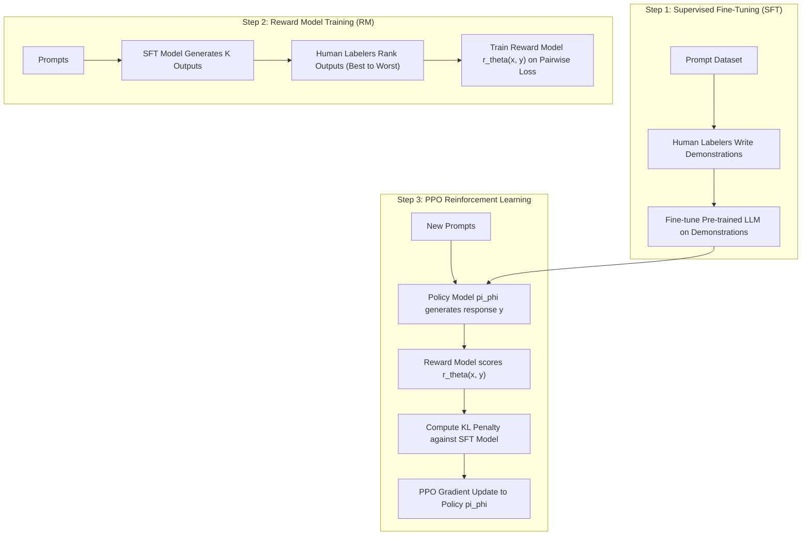

# InstructGPT: Training Language Models to Follow Instructions with Human Feedback

**Title:** Training language models to follow instructions with human feedback  
**Authors:** Long Ouyang et al. (OpenAI)  
**Venue / Year:** NeurIPS 2022  
**arXiv:** [2203.02155](https://arxiv.org/abs/2203.02155)  
**Category:** Alignment & Reinforcement Learning from Human Feedback (RLHF)  

---

## 1. Executive Summary & Core Innovation
InstructGPT established the standard three-step alignment framework combining Supervised Fine-Tuning (SFT), Reward Modeling (RM), and Proximal Policy Optimization (PPO). The authors showed that raw next-token language models often fail to follow user intent—frequently generating toxic, repetitive, or irrelevant responses. By aligning a 1.3B parameter model with human feedback, it outperformed a 175B parameter unaligned GPT-3 model on human preference evaluations.

---

## 2. Problem Landscape: The Alignment Problem
Large language models trained purely with next-token prediction objective ($\min -\sum \log P(x_t \mid x_{<t})$) are optimized to imitate internet text, not to be helpful or safe. When given a prompt such as:
> *"Explain quantum computing to a 6-year-old."*

An unaligned model might simply continue the text with more internet forum quotes, ask follow-up questions, or fabricate fictional stories instead of following instructions. InstructGPT aligns models along three primary criteria: **Helpfulness, Honesty, and Harmlessness (the 3 H's)**.

---

## 3. The 3-Step RLHF Pipeline

---

## 4. Mathematical Formulation

### 4.1 Reward Model Pairwise Ranking Loss
Rather than asking annotators for absolute scalar scores, labelers rank multiple model outputs $y_w \succ y_l$ (preferred $y_w$ over dispreferred $y_l$). The reward model loss is:

$$\mathcal{L}_{\text{RM}}(\theta) = -\mathbb{E}_{(x, y_w, y_l) \sim D}\left[\log \sigma\left(r_\theta(x, y_w) - r_\theta(x, y_l)\right)\right]$$

### 4.2 PPO Optimization with KL Divergence Penalty
During RL optimization, the policy $\pi_\phi^{\text{RL}}$ must maximize reward without drifting too far from the initial supervised policy $\pi^{\text{SFT}}$ (to prevent reward hacking and degradation of language coherence):

$$\text{obj}(\phi) = \mathbb{E}_{(x, y) \sim D_{\pi_\phi^{\text{RL}}}}\left[r_\theta(x, y) - \beta D_{\text{KL}}\left(\pi_\phi^{\text{RL}}(y \mid x) \parallel \pi^{\text{SFT}}(y \mid x)\right)\right] + \gamma \mathbb{E}_{x \sim D_{\text{pretrain}}}[\log \pi_\phi^{\text{RL}}(x)]$$

- $\beta D_{\text{KL}}$ penalizes deviation from the anchor model.
- $\gamma \mathbb{E}[\log \pi(x)]$ preserves performance on general NLP benchmarks (preventing the "alignment tax").

---

## 5. Landmark Impact
InstructGPT became the direct technological precursor to **ChatGPT**, demonstrating that alignment, rather than raw parameter scaling alone, is what transforms autocomplete models into usable AI assistants.
