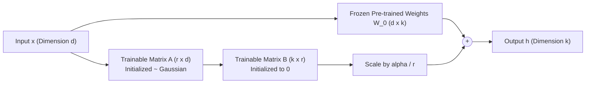

# LoRA: Low-Rank Adaptation of Large Language Models

**Title:** LoRA: Low-Rank Adaptation of Large Language Models  
**Authors:** Edward J. Hu, Yelong Shen, Phillip Wallis, Zeyuan Allen-Zhu, Yuanzhi Li, Shean Wang, Lu Wang, Weizhu Chen (Microsoft)  
**Venue / Year:** ICLR 2022  
**arXiv:** [2106.09685](https://arxiv.org/abs/2106.09685)  
**Category:** Parameter-Efficient Fine-Tuning (PEFT)  

---

## 1. Executive Summary & Core Innovation
LoRA freezes the pre-trained model weights and injects trainable rank decomposition matrices into each Transformer layer. Grounded in the hypothesis that weight updates during downstream adaptation have a low "intrinsic dimension," LoRA reduces the number of trainable parameters by up to 10,000x and GPU memory consumption by 3x, while matching or exceeding full fine-tuning performance with zero additional inference latency.

---

## 2. Motivation: The Prohibitive Cost of Full Fine-Tuning
As foundation models scaled past hundreds of billions of parameters, conventional full fine-tuning became impractical:
- Storing a separate 175B parameter checkpoint (~350 GB in FP16) for each task is cost-prohibitive.
- Training requires storing optimizer states (Adam requires 8 bytes per parameter: FP32 momentum + variance), consuming enormous VRAM.
- Prior parameter-efficient methods (e.g. series adapters) introduced sequential layers that added significant inference latency.

---

## 3. Mathematical Formulation

### 3.1 Low-Rank Matrix Factorization
For a pre-trained weight matrix $W_0 \in \mathbb{R}^{d \times k}$, its update $\Delta W$ is constrained by representing it through low-rank decomposition:

$$\Delta W = B \cdot A$$

where $B \in \mathbb{R}^{d \times r}$, $A \in \mathbb{R}^{r \times k}$, and the rank $r \ll \min(d, k)$.

During forward computation on input $x$:

$$h = W_0 x + \Delta W x = W_0 x + \frac{\alpha}{r} B A x$$

### 3.2 Initialization & Scaling Factor
- **Initialization**: Matrix $A$ is initialized from a random Gaussian distribution $\mathcal{N}(0, \sigma^2)$, and matrix $B$ is initialized to 0. Consequently, $\Delta W = BA = 0$ at the start of training, ensuring the model's pre-trained behavior is preserved initially.
- **Scaling Factor $\frac{\alpha}{r}$**: $\alpha$ is a constant hyperparameter. Scaling by $\frac{\alpha}{r}$ stabilizes optimization when adjusting the rank $r$.

### 3.3 Zero Inference Latency
During deployment, the learned adapter can be merged directly into the base weights:

$$W_{\text{deployed}} = W_0 + \frac{\alpha}{r} B A$$

This eliminates any runtime branching, achieving identical latency to the original base model.

---

## 4. Key Findings
- **Intrinsic Rank $r$ Can Be Extremely Small**: Setting $r=1, 2, \text{ or } 4$ is often sufficient for downstream tasks across GPT-3 and RoBERTa.
- **Which Weights to Adapt**: Adapting both query ($W_q$) and value ($W_v$) projection matrices in self-attention delivers the highest performance gains.
