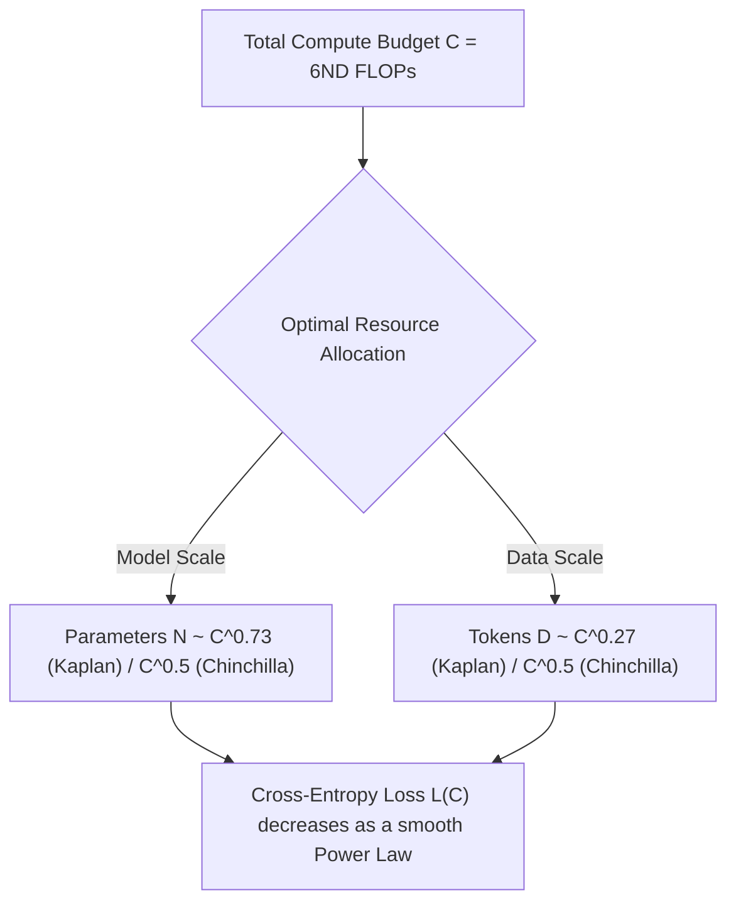

# Scaling Laws for Neural Language Models

**Title:** Scaling Laws for Neural Language Models  
**Authors:** Jared Kaplan et al. (OpenAI)  
**Venue / Year:** arXiv 2020  
**arXiv:** [2001.08361](https://arxiv.org/abs/2001.08361)  
**Category:** Scaling Theory & Empirical Optimization  

---

## 1. Executive Summary & Core Innovation
This landmark empirical study demonstrated that the cross-entropy loss of autoregressive language models follows clean power-law scaling relationships spanning many orders of magnitude. The performance of language models depends strongly on three macroscopic factors: parameter count ($N$), dataset token count ($D$), and total compute ($C$), while displaying weak dependence on architectural hyperparameters like depth, width, or attention heads when model shape is within reasonable ranges.

---

## 2. Core Scaling Principles

### 2.1 Power-Law Equations
When performance is not bottlenecked by one of the other resources:

1. **Parameters ($N$)**: With infinite data, test loss scales as:
   $$L(N) \approx \left(\frac{N_c}{N}\right)^{\alpha_N}, \quad \alpha_N \approx 0.076$$
2. **Dataset Size ($D$)**: With an arbitrarily large model, test loss scales as:
   $$L(D) \approx \left(\frac{D_c}{D}\right)^{\alpha_D}, \quad \alpha_D \approx 0.095$$
3. **Compute ($C$)**: When simultaneously scaling $N$ and $D$ under compute budget $C \approx 6 N D$:
   $$L(C) \approx \left(\frac{C_c}{C}\right)^{\alpha_C}, \quad \alpha_C \approx 0.050$$

---

## 3. Key Theoretical & Practical Insights

1. **Smooth Continuum Across Scales**:
   Performance improves predictably across scales spanning 100k to 10B+ parameters. There are no sudden cliffs or phase transitions in cross-entropy loss, even though downstream capabilities may appear "emergent" when evaluated with non-linear threshold metrics.
2. **Architecture Agnosticism**:
   Within wide boundaries, varying the depth-to-width ratio or changing head counts makes negligible difference compared to total parameter count.
3. **Overfitting Avoidance**:
   The paper showed that scaling parameter count ($N$) while keeping data ($D$) fixed leads to predictable overfitting penalties following $(N^{0.74}/D)$.
4. **Historical Legacy & The Chinchilla Correction**:
   Kaplan's original scaling laws recommended scaling parameters faster than tokens ($N \propto C^{0.73}, D \propto C^{0.27}$). Later, Hoffmann et al. (Chinchilla, 2022) identified that models were severely undertrained and showed that compute-optimal scaling requires scaling model size and tokens in equal proportion ($N \propto C^{0.5}, D \propto C^{0.5}$).
