# FlashAttention: Fast and Memory-Efficient Exact Attention with IO-Awareness

**Title:** FlashAttention: Fast and Memory-Efficient Exact Attention with IO-Awareness  
**Authors:** Tri Dao, Daniel Y. Fu, Stefano Ermon, Atri Rudra, Christopher Ré (Stanford University)  
**Venue / Year:** NeurIPS 2022  
**arXiv:** [2205.14135](https://arxiv.org/abs/2205.14135)  
**Category:** Systems, Hardware Optimization & Long Context  

---

## 1. Executive Summary & Core Innovation
FlashAttention re-engineered the exact self-attention computation around the GPU memory hierarchy. Standard attention algorithms materialize the intermediate $N \times N$ attention matrix in slow GPU High Bandwidth Memory (HBM). FlashAttention uses **tiling** and **online softmax** to compute exact attention in fast on-chip SRAM, reducing HBM reads and writes from $O(N^2)$ to $O(N)$. This delivered 2-4x end-to-end wall-clock speedups, dramatically reduced VRAM footprints, and enabled training with contexts of 16k to 100k+ tokens.

---

## 2. Hardware Landscape: The Memory-Bound Barrier
On modern GPU architectures (such as NVIDIA A100 / H100), compute throughput (FLOPs/s) has grown far faster than memory bandwidth (Bytes/s):
- **SRAM (On-Chip)**: Extremely fast (~19 TB/s on A100), but small capacity (~20 MB).
- **HBM (High Bandwidth Memory)**: Slower (~1.5–2.0 TB/s on A100), but large capacity (40–80 GB).

Standard attention executes:
$$S = Q K^T \in \mathbb{R}^{N \times N} \quad (\text{write to HBM})$$
$$P = \text{softmax}(S) \in \mathbb{R}^{N \times N} \quad (\text{read from HBM, write to HBM})$$
$$O = P V \in \mathbb{R}^{N \times d} \quad (\text{read } P \text{ from HBM})$$

Because $N \times N$ is repeatedly read from and written to HBM, the kernel is severely **memory-bandwidth bound**, leaving tensor cores mostly idle.

---

## 3. Core Mechanisms of FlashAttention

```mermaid
flowchart TD
    subgraph StandardAttention ["Standard Attention (Memory Bound)"]
        HBM_Q["Q, K, V in HBM"] --> Read1["Read to SRAM"]
        Read1 --> Mat1["Compute S = QK^T"]
        Mat1 --> Write1["Write S (NxN) to HBM"]
        Write1 --> Read2["Read S from HBM"]
        Read2 --> Soft["Compute P = softmax(S)"]
        Soft --> Write2["Write P (NxN) to HBM"]
        Write2 --> Read3["Read P, V from HBM"]
        Read3 --> Mat2["Compute O = PV"]
        Mat2 --> Write3["Write O to HBM"]
    end

    subgraph FlashAttention ["FlashAttention (IO-Aware Tiling)"]
        HBM_Tile["Load Blocks Q_i, K_j, V_j into fast SRAM"] --> Fused["Fused Kernel in SRAM:<br/>1. Tile Matrix Multiply S_ij<br/>2. Online Softmax Update (m_i, l_i)<br/>3. Accumulate Output O_i"]
        Fused --> WriteO["Write final O_i directly to HBM"]
    end
```

### 3.1 Tiling
FlashAttention splits inputs $Q, K, V$ into blocks of size $B_r \times d$ and $B_c \times d$ that comfortably fit inside fast SRAM.

### 3.2 Online Softmax
To compute softmax over blocks without materializing the full row vector, FlashAttention maintains running scaling factors:

$$m_i^{(j)} = \max\left(m_i^{(j-1)}, \max(S_{ij})\right)$$

$$\ell_i^{(j)} = e^{m_i^{(j-1)} - m_i^{(j)}} \ell_i^{(j-1)} + \sum e^{S_{ij} - m_i^{(j)}}$$

This enables incremental output accumulation across block chunks without storing intermediate matrices.

---

## 4. Impact on Modern LLMs
- **Zero Approximation**: Computes mathematically identical attention values down to floating-point precision.
- **Hardware Efficiency**: Boosted GPU compute utilization from ~20-30% to over 50-60% of theoretical peak FLOPs.
- **Universal Standard**: Built directly into PyTorch (`F.scaled_dot_product_attention`), vLLM, and every modern LLM training framework.
