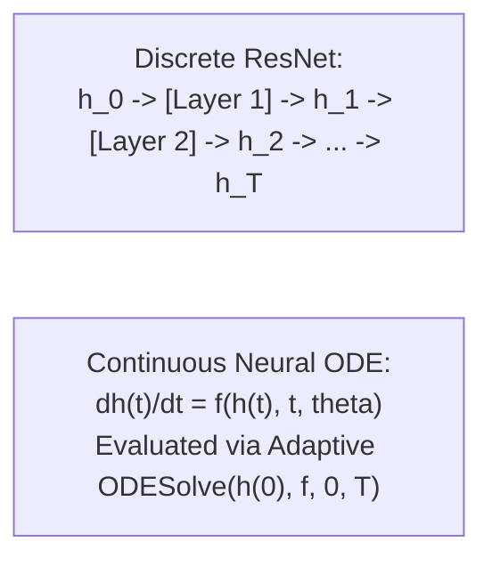

# Neural Ordinary Differential Equations (Neural ODEs)

**Title:** Neural Ordinary Differential Equations  
**Authors:** Ricky T. Q. Chen, Yulia Rubanova, Jesse Bettencourt, David Duvenaud (University of Toronto, Vector Institute)  
**Venue / Year:** NeurIPS 2018 (Best Paper Award)  
**arXiv:** [1810.01340](https://arxiv.org/abs/1810.01340)  
**Category:** Continuous-Depth Models & Dynamical Systems  

---

## 1. Executive Summary & Core Innovation
Neural ODEs introduce a new family of deep neural network models where continuous-depth hidden states are defined by a system of ordinary differential equations rather than a discrete sequence of stacked layers. Instead of specifying a fixed sequence of transformations $h_{t+1} = h_t + f(h_t, \theta_t)$, the model parameterizes the continuous derivative of the state using a neural network. Gradients are computed in $O(1)$ memory using the continuous adjoint sensitivity method, effectively turning numerical ODE solvers into a core deep learning primitive.

---

## 2. Motivation: The Discrete Limit of Residual Networks
In standard ResNet architectures, the state transition across layers is discrete:

$$h_{t+1} = h_t + f(h_t, \theta_t)$$

In the continuous limit as step size $\Delta t \to 0$:

$$\frac{h(t + \Delta t) - h(t)}{\Delta t} \approx \frac{dh(t)}{dt} = f(h(t), t, \theta)$$

The final output is the solution to an Initial Value Problem (IVP) evaluated at time $T$:

$$h(T) = h(0) + \int_0^T f(h(t), t, \theta) \, dt = \text{ODESolve}(h(0), f, 0, T, \theta)$$

---

## 3. Mathematical Formulation & The Adjoint Sensitivity Method

### 3.1 Constant Memory Backpropagation
Standard reverse-mode automatic differentiation through an adaptive ODE solver would require caching all intermediate internal evaluation stages, consuming memory proportional to the number of solver steps. 

Neural ODEs solve this with the **Adjoint Sensitivity Method** (Pontryagin's maximum principle). Defining the adjoint state as:

$$a(t) = \frac{\partial \mathcal{L}}{\partial h(t)}$$

Its continuous dynamics follow another differential equation:

$$\frac{da(t)}{dt} = -a(t)^T \frac{\partial f(h(t), t, \theta)}{\partial h}$$

Gradients with respect to network parameters $\theta$ are obtained by integrating backwards from $T$ to $0$:

$$\frac{\partial \mathcal{L}}{\partial \theta} = -\int_T^0 a(t)^T \frac{\partial f(h(t), t, \theta)}{\partial \theta} \, dt$$

This entire backward pass runs in **$O(1)$ memory footprint** regardless of the number of ODE solver evaluations.

---

## 4. Landmark Impact
- **Continuous-Time Modeling**: Naturally handles irregularly sampled time-series data without heuristic imputation or binning.
- **Invertible Architectures**: Paved the way for Continuous Normalizing Flows (FFJORD) and continuous diffusion bridges.
- **Adaptive Computation**: Adjusts depth dynamically at test time: high tolerance delivers fast low-precision inference; tight tolerance delivers exact precision.
