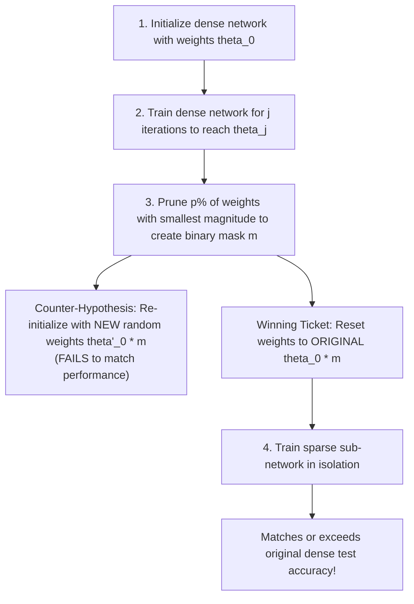

# The Lottery Ticket Hypothesis: Finding Sparse, Trainable Neural Networks

**Title:** The Lottery Ticket Hypothesis: Finding Sparse, Trainable Neural Networks  
**Authors:** Jonathan Frankle, Michael Carbin (MIT CSAIL)  
**Venue / Year:** ICLR 2019 (Best Paper Award)  
**arXiv:** [1803.03635](https://arxiv.org/abs/1803.03635)  
**Category:** Network Pruning, Sparsity & Optimization Theory  

---

## 1. Executive Summary & Core Innovation
The Lottery Ticket Hypothesis posits that dense, randomly-initialized feed-forward networks contain small, sparse sub-networks ("winning lottery tickets") that—when trained in isolation from their original initialization—can match or exceed the test accuracy of the original dense network in an equal or lesser number of training iterations. This challenged the consensus that over-parameterization was fundamentally necessary throughout the optimization trajectory.

---

## 2. Core Hypothesis & The Winning Ticket Concept

> **The Lottery Ticket Hypothesis**: A randomly-initialized, dense neural network contains a sub-network that is initialized such that—when trained in isolation—it can match the test accuracy of the original network after training for at most the same number of iterations.

---

## 3. Iterative Magnitude Pruning (IMP) Algorithm

1. Randomly initialize a neural network with parameters $\theta_0 \sim \mathcal{D}_\theta$.
2. Train the network for $T$ iterations, arriving at parameters $\theta_T$.
3. Prune the lowest-magnitude $p\%$ of weights in each layer, constructing a binary mask $m \in \{0, 1\}^{|\theta|}$.
4. **Key Reset Step**: Reset the remaining weights back to their exact original values at initialization:
   $$m \odot \theta_0$$
   *(Crucial: If the weights are randomly re-initialized instead of reset to $\theta_0$, the subnetwork fails to train effectively).*
5. Repeat iteratively across multiple pruning rounds to uncover extreme sparsity (e.g., remaining $10\%$ to $1\%$ of weights).

---

## 4. Key Discoveries & Theoretical Significance
- **Importance of Initialization Synergy**: The winning sub-network succeeds not merely because of its topological connectivity mask $m$, but because of the specific alignment between mask $m$ and the initial random weights $\theta_0$.
- **Late Resetting for Deep Models**: In larger networks (like deep ResNets or Transformers), resetting to $\theta_0$ can be unstable. Resetting to an early training checkpoint $\theta_k$ (e.g., after warmup at iteration $k$) consistently recovers winning tickets across all model classes.
- **Foundation for Efficient AI**: Sparked extensive research into pre-training sparsity, unstructured/structured pruning, and modern parameter-efficient tuning techniques like LoRA.
