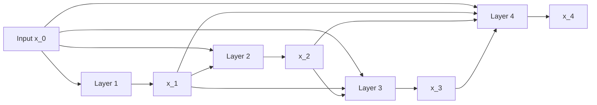

# Densely Connected Convolutional Networks (DenseNet)

**Title:** Densely Connected Convolutional Networks  
**Authors:** Gao Huang, Zhuang Liu, Laurens van der Maaten, Kilian Q. Weinberger (Cornell University, Tsinghua University, Facebook AI Research)  
**Venue / Year:** CVPR 2017 (Best Paper Award)  
**arXiv:** [1608.06993](https://arxiv.org/abs/1608.06993)  
**Category:** Vision Architectures & Feature Reuse  

---

## 1. Executive Summary & Core Innovation
DenseNet introduced a radical architectural principle for convolutional networks: each layer connects to every other layer in a feed-forward fashion. Whereas traditional networks with $L$ layers have $L$ connections (one between each layer and its successor), a DenseNet has $\frac{L(L+1)}{2}$ direct connections. By concatenating feature maps from all preceding layers rather than summing them (as in ResNet), DenseNet maximizes feature reuse, mitigates the vanishing-gradient problem, and substantially reduces parameter redundancy.

---

## 2. Comparison: ResNet (Summation) vs DenseNet (Concatenation)

### 2.1 ResNet Formulation (Additive Skip Connections)
$$x_\ell = H_\ell(x_{\ell-1}) + x_{\ell-1}$$
The additive identity shortcut mapping facilitates gradient flow, but can impede the representation capacity of distinct feature maps by blending them directly into the same tensor stream.

### 2.2 DenseNet Formulation (Concatenation)
$$x_\ell = H_\ell([x_0, x_1, x_2, \dots, x_{\ell-1}])$$
where $[x_0, x_1, \dots, x_{\ell-1}]$ denotes the channel-wise concatenation of feature maps produced by all preceding layers.

---

## 3. Mathematical Formulation & Dense Block Mechanics

### 3.1 Growth Rate ($k$)
Because each layer receives all preceding feature maps, a naive channel expansion would cause exploding channel dimensions. DenseNet introduces a narrow **growth rate** $k$ (typically $k=12$ or $k=32$). If each composite function $H_\ell$ produces $k$ feature maps, the $\ell^{\text{th}}$ layer has:

$$k_0 + k \times (\ell - 1) \quad \text{input channels}$$

where $k_0$ is the number of channels in the input image.

### 3.2 Transition Layers
To change feature map spatial sizes between dense blocks, DenseNet introduces transition layers consisting of a $1 \times 1$ convolution (with compression factor $\theta \le 1$) followed by $2 \times 2$ average pooling:

$$m_{\text{out}} = \lfloor \theta \cdot m_{\text{in}} \rfloor$$

---

## 4. Key Advantages
1. **Implicit Deep Supervision**: Every layer receives direct gradient feedback from the loss function through short paths.
2. **Compact Parameter Efficiency**: Features learned early in the network do not need to be re-learned by deeper layers, achieving competitive accuracy with roughly half the parameters of comparable ResNets.
3. **Pervasive Feature Diversity**: Retains low-level geometric features alongside high-level semantic features throughout the network depth.
