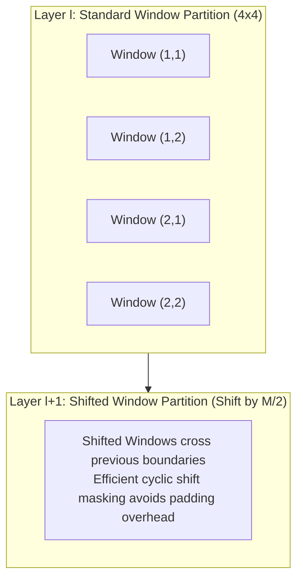

# Swin Transformer: Hierarchical Vision Transformer using Shifted Windows

**Title:** Swin Transformer: Hierarchical Vision Transformer using Shifted Windows  
**Authors:** Ze Liu, Yutong Lin, Yue Cao, Han Hu, Yixuan Wei, Zheng Zhang, Stephen Lin, Baining Guo (Microsoft Research Asia)  
**Venue / Year:** ICCV 2021 (Marr Prize - Best Paper Award)  
**arXiv:** [2103.14030](https://arxiv.org/abs/2103.14030)  
**Category:** Hierarchical Vision & Linear-Complexity Attention  

---

## 1. Executive Summary & Core Innovation
While the standard Vision Transformer (ViT) produces feature maps of a single fixed scale with $O(N^2)$ computational complexity relative to image size, the **Swin Transformer** builds a hierarchical representation with **linear computational complexity $O(N)$**. By limiting self-attention to local non-overlapping windows and alternating with **Shifted Window partitioning (SW-MSA)** between consecutive layers, Swin achieves cross-window connections while serving as a general-purpose vision backbone suitable for high-resolution dense prediction tasks like object detection and semantic segmentation.

---

## 2. Motivation: The Challenges of ViT in Dense Vision
1. **Scale Variations**: Objects in images vary drastically in scale (unlike words in text). ViT's uniform token granularity struggles with multi-scale feature representations.
2. **High-Resolution Pixel Grids**: For dense prediction tasks (e.g. $1024 \times 1024$ segmentation), global attention scales quadratically ($O((HW)^2)$), rendering standard ViT computationally infeasible.

---

## 3. Mathematical Formulation & Shifted Window Attention

### 3.1 Local Window Self-Attention (W-MSA)
Given an image containing $h \times w$ patches, partitioning into local windows of size $M \times M$ (typically $M=7$):
- Global Attention Complexity: $\mathcal{O}\left(4hwC^2 + 2(hw)^2C\right)$ (quadratic in image resolution $hw$).
- Window-based Attention Complexity: $\mathcal{O}\left(4hwC^2 + 2M^2hwC\right)$ (**linear in image resolution $hw$**).

### 3.2 Shifted Window Partitioning (SW-MSA)
To introduce cross-window connections without incurring global computation, the window partitioning is shifted by $\left(\lfloor \frac{M}{2} \rfloor, \lfloor \frac{M}{2} \rfloor\right)$ patches between consecutive layers:

$$\hat{z}^\ell = \text{W-MSA}(\text{LN}(z^{\ell-1})) + z^{\ell-1}$$

$$z^\ell = \text{MLP}(\text{LN}(\hat{z}^\ell)) + \hat{z}^\ell$$

$$\hat{z}^{\ell+1} = \text{SW-MSA}(\text{LN}(z^\ell)) + z^\ell$$

$$z^{\ell+1} = \text{MLP}(\text{LN}(\hat{z}^{\ell+1})) + \hat{z}^{\ell+1}$$

---

## 4. Key Results & Landmark Legacy
- **Won the Marr Prize at ICCV 2021** (highest honor in computer vision).
- SOTA across ImageNet classification (87.3% top-1), COCO object detection (58.7 box AP), and ADE20K semantic segmentation (53.5 mIoU).
- Proved that hierarchical feature pyramids and spatial inductive locality can be re-introduced into Transformers with linear compute efficiency.
