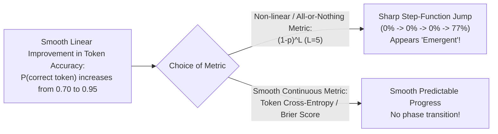

# Are Emergent Abilities of Large Language Models a Mirage?

**Title:** Are Emergent Abilities of Large Language Models a Mirage?  
**Authors:** Rylan Schaeffer, Brando Miranda, Sanmi Koyejo (Stanford University)  
**Venue / Year:** NeurIPS 2023 (Outstanding Paper Award)  
**arXiv:** [2304.15004](https://arxiv.org/abs/2304.15004)  
**Category:** LLM Science, Evaluation & Scaling Dynamics  

---

## 1. Executive Summary & Core Innovation
Prior work widely reported that Large Language Models exhibit "emergent abilities"—sharp, unpredictable phase transitions where performance appears near zero below a threshold scale, and then abruptly jumps to high accuracy. This influential paper proved that these emergent discontinuities are largely an **artifact of the evaluation metric chosen by researchers** (a "mirage") rather than fundamental non-linearities in the model's internal capability. When evaluated using smooth, continuous metrics instead of non-linear, discontinuous threshold metrics (like exact string match or multiple-choice accuracy), the apparent emergent jumps vanish, revealing smooth, predictable improvements.

---

## 2. Mathematical Anatomy of the Mirage

Let the model's token-level error rate be $p$. As parameter count or compute scales, token accuracy typically improves smoothly according to a power law:

$$p \propto C^{-\alpha}$$

### 2.1 The Discontinuous Metric Effect
Consider an evaluation metric that requires predicting a target string of length $L$ completely correctly (e.g., Exact Match / Accuracy):

$$\text{Accuracy} = (1 - p)^L$$

When $L$ is large:
- At $p = 0.5$, $\text{Accuracy} = (0.5)^5 \approx 0.03$ (appears to be 0%).
- At $p = 0.2$, $\text{Accuracy} = (0.8)^5 \approx 0.33$.
- At $p = 0.05$, $\text{Accuracy} = (0.95)^5 \approx 0.77$.

To an external observer, the model appears to suddenly acquire the ability at scale, when in reality its token prediction accuracy was advancing with predictable linearity.

---

## 3. The Three Mathematical Predictions & Empirical Proofs
The authors verified three distinct predictions to confirm their hypothesis:
1. **Metric Substitution**: Changing the evaluation metric on the exact same model checkpoints from a non-linear metric (accuracy) to a linear metric (Brier score, token edit distance, per-token probability) eliminates the sharp transition.
2. **Controlling Output Length ($L$)**: As the required sequence length $L$ increases, the sharpness of the transition steepens predictably according to the geometric series $(1 - p)^L$.
3. **Synthetic Capability Testing**: In non-neural models and synthetic networks with purely linear capabilities, introducing non-linear threshold metrics artificially reproduces the illusion of "emergence."

---

## 4. Philosophical & Safety Implications
- **Predictability in AI Safety**: If scaling behavior is continuous under smooth metrics, catastrophic unexpected jumps in capabilities are less likely to occur unheralded.
- **Scientific Rigor in Benchmarking**: Highlights the danger of confusing non-linear human measurement instruments with the underlying computational representations of deep networks.
