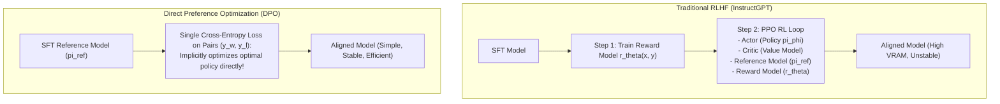

# Direct Preference Optimization (DPO): Your Language Model is Secretly a Reward Model

**Title:** Direct Preference Optimization: Your Language Model is Secretly a Reward Model  
**Authors:** Rafael Rafailov, Archit Sharma, Eric Mitchell, Stefano Ermon, Christopher D. Manning, Chelsea Finn (Stanford University)  
**Venue / Year:** NeurIPS 2023 (Landmark Oral)  
**arXiv:** [2305.18290](https://arxiv.org/abs/2305.18290)  
**Category:** Alignment, Preference Learning & Post-Training  

---

## 1. Executive Summary & Core Innovation
Direct Preference Optimization (DPO) solved the notorious complexity and instability of Reinforcement Learning from Human Feedback (RLHF). While traditional RLHF (InstructGPT) requires training a separate reward model and fine-tuning the policy with complex actor-critic algorithms like PPO (requiring multiple models held in GPU VRAM and fragile hyperparameter tuning), DPO mathematically shows that the constrained RL problem has an exact closed-form solution. This allows direct optimization of the language model policy on pairwise human preferences using a simple binary cross-entropy loss, completely eliminating the reward model and PPO reinforcement learning loop.

---

## 2. Comparison: PPO-RLHF vs Direct Preference Optimization

---

## 3. Mathematical Derivation

### 3.1 The Constrained RL Objective
The canonical RLHF objective maximizes expected reward while penalizing KL divergence from a reference policy $\pi_{\text{ref}}$:

$$\max_{\pi} \mathbb{E}_{x \sim \mathcal{D}, y \sim \pi(y \mid x)}\left[r(x, y)\right] - \beta \mathbb{D}_{\text{KL}}\left(\pi(y \mid x) \parallel \pi_{\text{ref}}(y \mid x)\right)$$

### 3.2 The Closed-Form Optimal Policy
The exact analytical solution to this optimization problem is given by:

$$\pi^*(y \mid x) = \frac{1}{Z(x)} \pi_{\text{ref}}(y \mid x) \exp\left(\frac{1}{\beta} r(x, y)\right)$$

where $Z(x) = \sum_y \pi_{\text{ref}}(y \mid x) \exp\left(\frac{1}{\beta} r(x, y)\right)$ is the partition function.

### 3.3 Expressing Reward in Terms of Policy
Rearranging the equation allows expressing the ground-truth reward function directly in terms of the optimal policy and reference policy:

$$r(x, y) = \beta \log \frac{\pi^*(y \mid x)}{\pi_{\text{ref}}(y \mid x)} + \beta \log Z(x)$$

### 3.4 The DPO Loss
Substituting this re-parameterized reward into the Bradley-Terry preference model ($P(y_w \succ y_l \mid x) = \sigma(r(x, y_w) - r(x, y_l))$) causes the difficult partition function $Z(x)$ to cancel out entirely!

$$\mathcal{L}_{\text{DPO}}(\pi_\theta; \pi_{\text{ref}}) = -\mathbb{E}_{(x, y_w, y_l) \sim \mathcal{D}}\left[\log \sigma\left(\beta \log \frac{\pi_\theta(y_w \mid x)}{\pi_{\text{ref}}(y_w \mid x)} - \beta \log \frac{\pi_\theta(y_l \mid x)}{\pi_{\text{ref}}(y_l \mid x)}\right)\right]$$

---

## 4. Key Discoveries & Impact
- **Elimination of Reward Modeling & PPO**: Requires only two models (the active policy $\pi_\theta$ and frozen reference policy $\pi_{\text{ref}}$), drastically cutting VRAM requirements.
- **Superior Training Stability**: Eliminates the high variance, policy collapse, and hyperparameter sensitivity typical of reinforcement learning.
- **Universal Industry Adoption**: Became the standard alignment algorithm for open-source foundation models (Llama 3, Mistral, Zephyr, Gemma).
