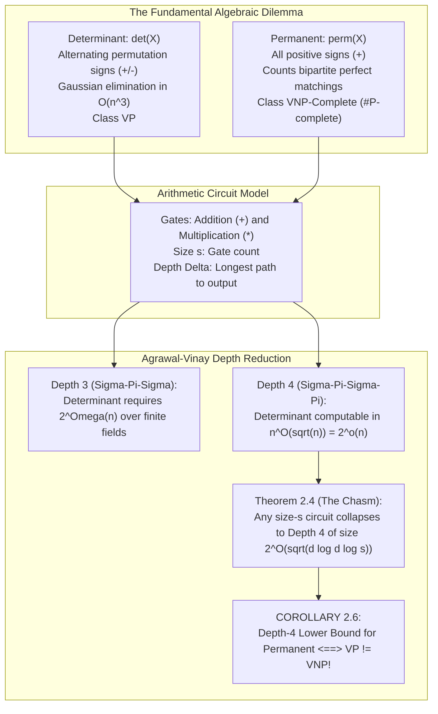

# Arithmetic Circuits: A Chasm at Depth Four (Agrawal & Vinay 2008)

**Title:** Arithmetic Circuits: A Chasm at Depth Four  
**Authors:** Manindra Agrawal (IIT Kanpur), V. Vinay (Geodesic Information Systems / Chennai Mathematical Institute)  
**Date / Venue:** Electronic Colloquium on Computational Complexity (ECCC TR08-062, 2008); IEEE FOCS 2008  
**Local PDF:** `papers/agrawal_vinay_2008_chasm_at_depth_four.pdf`  
**Category:** Theoretical Computer Science & Algebraic Complexity  
**Target Audience:** Recent graduates in Computer Science, Mathematics, or Electrical Engineering  

---

## 1. Executive Summary & Core Innovation
In this landmark 2008 paper, Manindra Agrawal and V. Vinay proved that proving exponential lower bounds on **depth-four arithmetic circuits** ($\Sigma\Pi\Sigma\Pi$) is sufficient to imply exponential lower bounds for **unrestricted-depth** arithmetic circuits. This established that for exponential-sized circuits, additional depth beyond four offers no fundamental asymptotic advantage. 

The paper solved a long-standing mystery in theoretical computer science: why researchers had been able to prove lower bounds for depth-3 circuits (Grigoriev & Razborov 2000), but hit an impenetrable wall when attempting depth 4, 5, or 6. Agrawal and Vinay revealed that there is no gradual incline: crossing depth four is already as hard as settling Valiant's grand challenge conjecture, $\text{VP} \neq \text{VNP}$!

---

## 2. Problem Landscape: The Determinant vs The Permanent

---

## 3. Core Mathematical Formulations for Recent Graduates

### 3.1 The Determinant ($\in \text{VP}$)
For an $n \times n$ matrix $X$:
$$\det(X) = \sum_{\sigma \in S_n} \operatorname{sgn}(\sigma) \prod_{i=1}^n X_{i, \sigma(i)}$$
- **Geometric Meaning**: Oriented volume scaling factor of the linear transformation.
- **Why it's in VP**: Because $\operatorname{sgn}(\sigma)$ alternates signs, row operations cancel terms, allowing computation in $O(n^3)$ operations via Gaussian elimination or division-free $O(n^4)$ via Mahajan & Vinay's clow sequences.

### 3.2 The Permanent ($\in \text{VNP-Complete}$)
$$\operatorname{perm}(X) = \sum_{\sigma \in S_n} \prod_{i=1}^n X_{i, \sigma(i)}$$
- **Combinatorial Meaning**: Counts perfect matchings in a bipartite graph.
- **Why it's in VNP**: Without sign alternations, row operations fail. Valiant proved that computing the permanent is $\#P$-complete.

---

## 4. The Depth Four Chasm Theorem (Theorem 2.4)
Let $P(x_1, \dots, x_n)$ be a polynomial of degree $d = O(n)$ over field $\mathbb{F}$. If there exists an arithmetic circuit of size:
$$M = 2^{o\left(d + d \log \frac{n}{d}\right)}$$
computing $P$, then there exists a **depth-four arithmetic circuit** ($\Sigma\Pi\Sigma\Pi$) of size:
$$2^{o\left(d + d \log \frac{n}{d}\right)}$$
computing $P$, where the multiplication gates have fan-in bounded by $o(d)$.

### The Permanent Corollary (Corollary 2.6)
> If every depth-4 arithmetic circuit computing the Permanent requires exponential size $2^{\Omega(n)}$, then **every arithmetic circuit of arbitrary (unrestricted) depth** computing the Permanent requires exponential size, proving $\text{VP} \neq \text{VNP}$!

---

## 5. Black-Box Polynomial Identity Testing (PIT) Derandomization
- **Theorem 3.2**: An optimal pseudorandom generator against restricted depth-4 circuits implies that general low-degree Polynomial Identity Testing can be solved deterministically in quasi-polynomial time $n^{O(\log n)}$.
- **Technique**: Combines the Nisan-Wigderson combinatorial design with Kaltofen's polynomial factorization algorithms.

---

## 6. Associated Artifacts in this Repository
- **Full Paper PDF**: `papers/agrawal_vinay_2008_chasm_at_depth_four.pdf`
- **15-Note Obsidian Vault**: `vaults/17_agrawal_vinay_chasm_depth_four-vault/00 Index.md`
- **NotebookLM Audio Overview Script**: `outputs/17_agrawal_vinay_chasm_depth_four/AUDIO_OVERVIEW_SCRIPT.md`
- **Technical Explainer Report**: `outputs/17_agrawal_vinay_chasm_depth_four/EXPLAINER_REPORT.md`
- **Interactive Slide Deck**: `outputs/17_agrawal_vinay_chasm_depth_four/slides.html`
- **Storyboard Video Frames**: `outputs/17_agrawal_vinay_chasm_depth_four/video_frames/`
