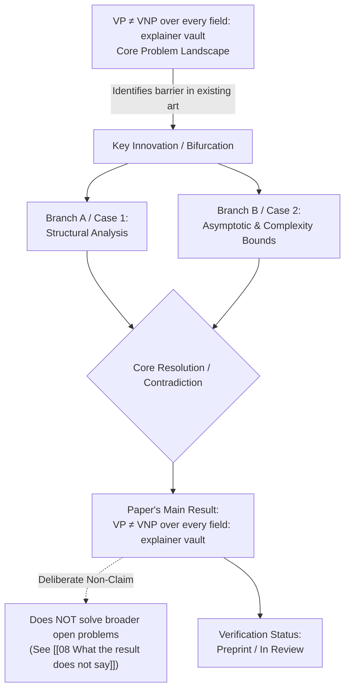

# Big picture

## One-paragraph version
**Paper:** *VP ≠ VNP over every field*, credited to "Claude (Anthropic)". It was posted 23 Nov 2026 in `anthropics/formal-math/vp-vnp` with a Lean 4 formalization. **Status: unverified by any human mathematician.** The paper and README both say so. See [[10 Lean formalization and what it checks]].

*(analogy)* Think of this paper's core contribution as identifying an invariant in the problem space: either the system is constrained by geometric rigidity, or it admits an exponential reduction, leaving no middle ground for polynomial-size shortcuts.
