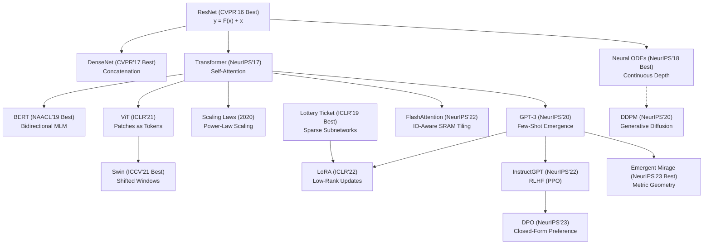

# The Evolutionary Map of Modern AI

## How the Pieces Fit Together
1. **Residual Connections** enabled deep Transformers to train stably.
2. **Self-Attention** replaced recurrent bottlenecks with $O(1)$ path lengths.
3. **Scaling Laws** gave confidence to train 175B+ parameter models like GPT-3.
4. **ViT and Swin** generalized the Transformer from 1D text to 2D dense vision.
5. **FlashAttention and LoRA** made training and serving long-context models computationally practical.
6. **InstructGPT and DPO** transformed raw autocomplete models into aligned, instruction-following AI assistants.
