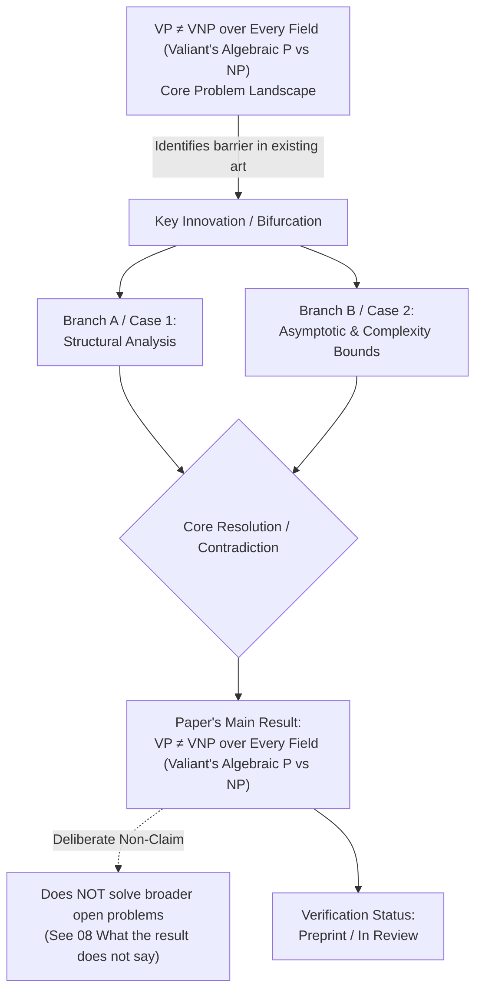

# Big picture

## One-paragraph version
**Date / Venue:** November 2026 Preprint & Lean 4 Formalization (`anthropics/formal-math/vp-vnp`)

*(analogy)* Think of this paper's core contribution as identifying an invariant in the problem space: either the system is constrained by geometric rigidity, or it admits an exponential reduction, leaving no middle ground for polynomial-size shortcuts.
