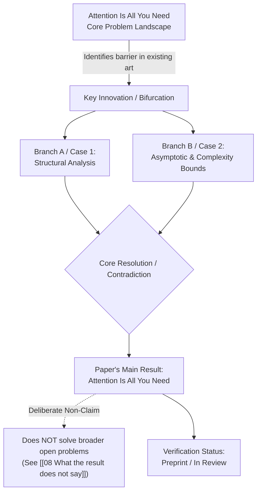

# Big picture

## One-paragraph version
**Authors:** Ashish Vaswani, Noam Shazeer, Niki Parmar, Jakob Uszkoreit, Llion Jones, Aidan N. Gomez, Lukasz Kaiser, Illia Polosukhin

*(analogy)* Think of this paper's core contribution as identifying an invariant in the problem space: either the system is constrained by geometric rigidity, or it admits an exponential reduction, leaving no middle ground for polynomial-size shortcuts.
