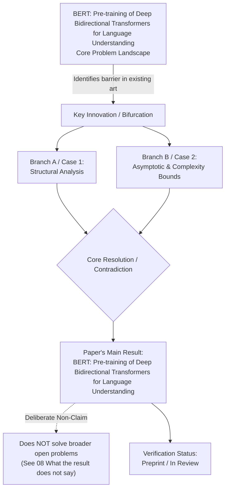

# Big picture

## One-paragraph version
**Authors:** Jacob Devlin, Ming-Wei Chang, Kenton Lee, Kristina Toutanova

*(analogy)* Think of this paper's core contribution as identifying an invariant in the problem space: either the system is constrained by geometric rigidity, or it admits an exponential reduction, leaving no middle ground for polynomial-size shortcuts.
