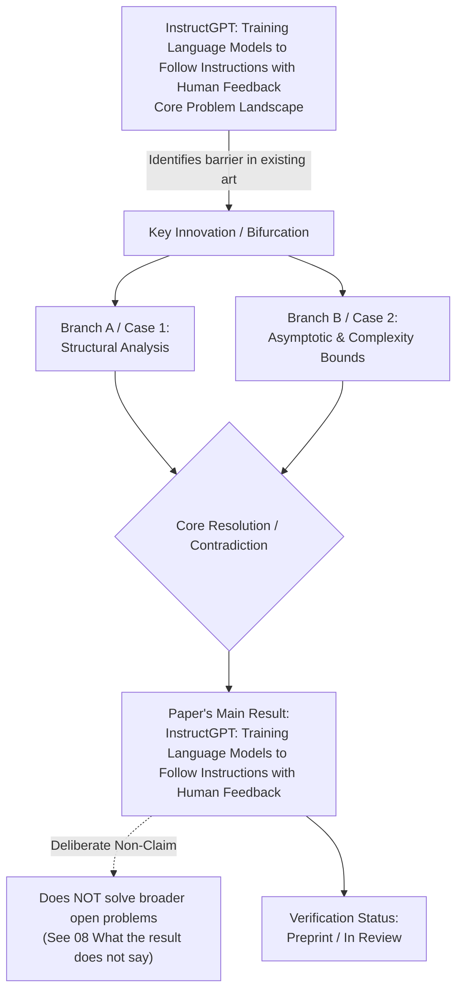

# Big picture

## One-paragraph version
**Title:** Training language models to follow instructions with human feedback

*(analogy)* Think of this paper's core contribution as identifying an invariant in the problem space: either the system is constrained by geometric rigidity, or it admits an exponential reduction, leaving no middle ground for polynomial-size shortcuts.
