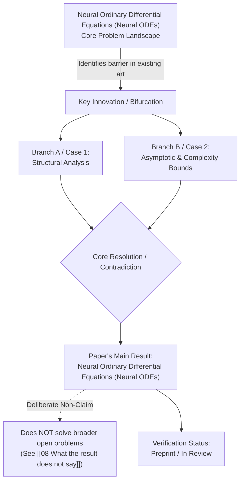

# Big picture

## One-paragraph version
**Authors:** Ricky T. Q. Chen, Yulia Rubanova, Jesse Bettencourt, David Duvenaud (University of Toronto, Vector Institute)

*(analogy)* Think of this paper's core contribution as identifying an invariant in the problem space: either the system is constrained by geometric rigidity, or it admits an exponential reduction, leaving no middle ground for polynomial-size shortcuts.
