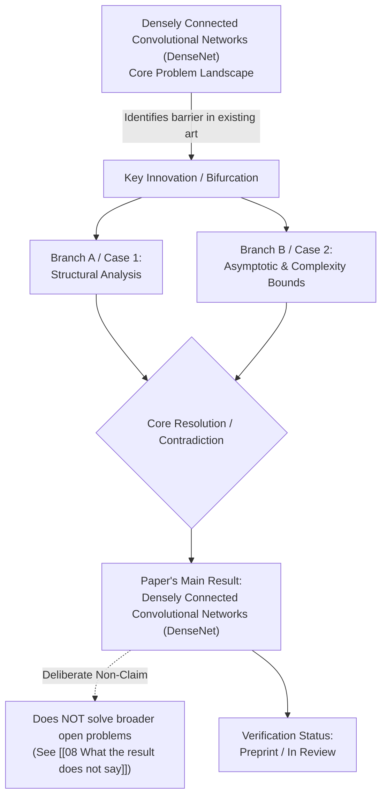

# Big picture

## One-paragraph version
**Authors:** Gao Huang, Zhuang Liu, Laurens van der Maaten, Kilian Q. Weinberger (Cornell University, Tsinghua University, Facebook AI Research)

*(analogy)* Think of this paper's core contribution as identifying an invariant in the problem space: either the system is constrained by geometric rigidity, or it admits an exponential reduction, leaving no middle ground for polynomial-size shortcuts.
