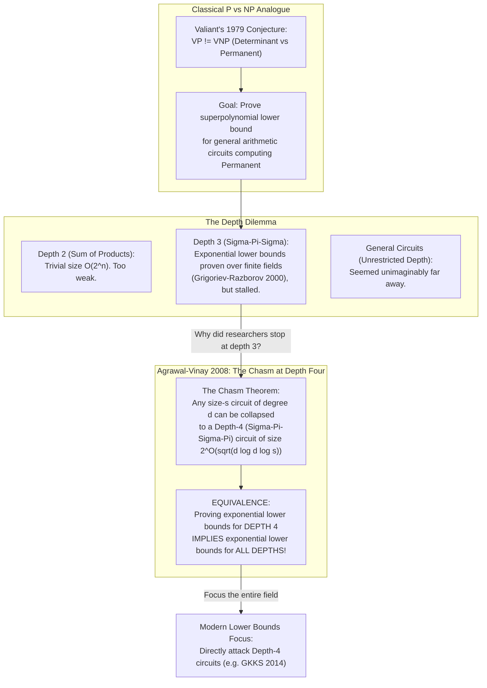

# Big Picture: The Chasm at Depth Four

## The One-Paragraph Summary

*(paper)* In **"Arithmetic Circuits: A Chasm at Depth Four"**, Manindra Agrawal and V. Vinay prove that proving exponential lower bounds on **depth-four arithmetic circuits** ($\Sigma\Pi\Sigma\Pi$) is sufficient to establish exponential lower bounds for **unrestricted-depth** arithmetic circuits. That is, for exponential-sized circuits, additional depth beyond four offers no fundamental asymptotic advantage. Furthermore, they prove that black-box derandomization of Polynomial Identity Testing (PIT) for restricted depth-four circuits implies a nearly complete ($n^{O(\log n)}$) derandomization of general PIT.

## Why is this called a "Chasm"?

*(analogy)* Imagine climbing a mountain of computational complexity:
- **Depth 2** ($\Sigma\Pi$, sum of monomials): trivial to analyze, but completely inefficient.
- **Depth 3** ($\Sigma\Pi\Sigma$): researchers could prove lower bounds, but depth 3 is fundamentally too weak to compute polynomials like the determinant efficiently.
- **General circuits**: allow arbitrarily deep recursive composition ($O(n)$ or $O(\log^2 n)$ depth), making them notoriously difficult to analyze.

Researchers assumed that to understand general circuits, they would have to slowly climb from depth 4, to depth 5, to depth 6, and beyond. Agrawal and Vinay proved that **there is no gradual mountain—there is a single chasm at depth 4**. If you can cross depth 4 by proving an exponential lower bound against $\Sigma\Pi\Sigma\Pi$ circuits, you have conquered the entire mountain and resolved the general circuit lower bound problem ($\mathrm{VP} 
eq \mathrm{VNP}$)!
