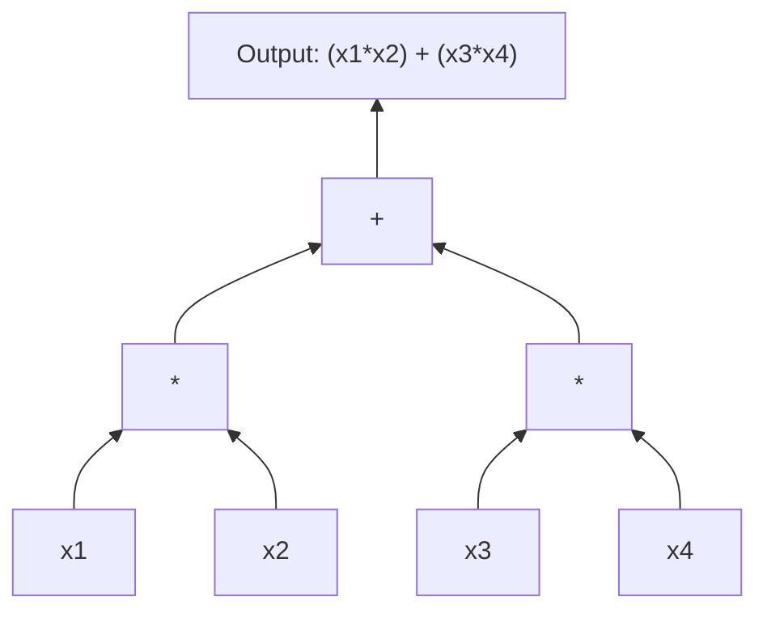

# Core Objects and Definitions: From Scratch

This document is designed for recent graduates in Computer Science, Mathematics, or Engineering. We build every concept from first principles.

---

## 1. What is a Matrix and a Linear Transformation?

An $n \times n$ matrix $A$ over a field $\mathbb{F}$ (e.g. real numbers $\mathbb{R}$ or complex numbers $\mathbb{C}$) is a square array of $n^2$ numbers:
$$A = \begin{pmatrix} a_{11} & a_{12} & \dots & a_{1n} \\ a_{21} & a_{22} & \dots & a_{2n} \\ \vdots & \vdots & \ddots & \vdots \\ a_{n1} & a_{n2} & \dots & a_{nn} \end{pmatrix}$$

*(analogy)* A matrix represents a linear transformation that takes an $n$-dimensional space and stretches, rotates, or shears it. 

---

## 2. What is the Determinant?

### Geometric Intuition: Volume Scaling
In 2D, if you take the standard unit square (area = 1) spanned by $\begin{pmatrix} 1 \\ 0 \end{pmatrix}$ and $\begin{pmatrix} 0 \\ 1 \end{pmatrix}$, and apply matrix $A = \begin{pmatrix} a & b \\ c & d \end{pmatrix}$, the unit square transforms into a parallelogram.
- The **area** of that parallelogram is $|ad - bc|$.
- The **Determinant** $\det(A) = ad - bc$ measures this **oriented volume scaling factor**.
- If $\det(A) = 0$, the transformation flattens the 2D plane into a 1D line (information is lost, matrix is not invertible).
- In $n$ dimensions, $\det(A)$ measures the oriented $n$-dimensional hypervolume of the parallelotope spanned by the column vectors of $A$.

### The Algebraic (Leibniz) Formula
For an $n \times n$ matrix $X = (x_{ij})$:
$$\det(X) = \sum_{\sigma \in S_n} \operatorname{sgn}(\sigma) \prod_{i=1}^n x_{i, \sigma(i)}$$
Where:
- $S_n$ is the symmetric group of all $n!$ permutations of $\{1, 2, \dots, n\}$.
- $\sigma$ is a permutation mapping row $i$ to column $\sigma(i)$.
- $\operatorname{sgn}(\sigma) \in \{+1, -1\}$ is the **sign (or parity)** of the permutation:
  - $+1$ if the permutation can be decomposed into an even number of swaps (transpositions).
  - $-1$ if it requires an odd number of swaps.

### Why is the Determinant Computationally Easy?
Even though the Leibniz formula has $n!$ terms (which is $\approx 2.4 \times 10^{18}$ terms for $n=20$!), the alternating signs $\operatorname{sgn}(\sigma)$ create massive algebraic cancellations:
1. **Gaussian Elimination**: By subtracting multiples of one row from another, row operations do not change the determinant. We can transform $A$ into an upper triangular matrix in $O(n^3)$ arithmetic operations!
2. **Division-Free Combinatorial Algorithms (Mahajan & Vinay 1997)**: Even if the field does not allow division (e.g. over arbitrary commutative rings), the determinant can be computed in polynomial time ($O(n^4)$) using closed walks ("clows") in a graph.
3. Therefore, $\det_n \in \mathbf{VP}$ (polynomial-size circuits).

---

## 3. What is the Permanent?

The Permanent looks almost identical to the Determinant, but **every term is positive**:
$$\operatorname{perm}(X) = \sum_{\sigma \in S_n} \prod_{i=1}^n x_{i, \sigma(i)}$$

### Combinatorial Meaning: Counting Matchings
If $X$ is the adjacency matrix of a bipartite graph $G = (V_1 \cup V_2, E)$ with $n$ vertices on each side:
- A product $\prod_{i=1}^n x_{i, \sigma(i)}$ equals $1$ if and only if each $(i, \sigma(i))$ is an edge in $G$.
- This means $\sigma$ is a **perfect matching** (pairing every worker to a unique task).
- Therefore, $\operatorname{perm}(X)$ counts the exact number of perfect matchings in the bipartite graph!

### Why is the Permanent Computationally Hard?
Because there are **no minus signs**, there are **no cancellations**!
- Gaussian elimination fails: adding or subtracting rows changes the permanent arbitrarily.
- Leslie Valiant proved in 1979 that computing the permanent is **$\#P$-complete** (exponentially harder than NP-complete decision problems).
- In algebraic complexity, the Permanent is the canonical **VNP-complete** polynomial.

---

## 4. What is an Arithmetic Circuit?

An **arithmetic circuit** over a field $\mathbb{F}$ is a directed acyclic graph (DAG) that computes a formal polynomial:
1. **Input Gates (Leaves, in-degree 0)**: Labeled with variables $x_1, x_2, \dots, x_n$ or field constants $c \in \mathbb{F}$.
2. **Internal Gates**:
   - **Addition Gate ($+$)**: Computes the sum of its incoming inputs.
   - **Multiplication Gate ($\times$)**: Computes the product of its incoming inputs.
3. **Output Gate (Root, out-degree 0)**: Outputs the final polynomial $P(x_1, \dots, x_n)$.

### Key Metrics of an Arithmetic Circuit:
- **Size ($s$ or $M$)**: Total number of gates (or edges) in the circuit. Represents the total computational work.
- **Depth ($\Delta$)**: The length of the longest directed path from an input gate to the output gate. Represents parallel time.
- **Fan-in**: The number of incoming edges to a gate. 
  - *Bounded fan-in*: usually fan-in $\le 2$ or a small constant.
  - *Unbounded fan-in*: arbitrary number of inputs.
- **Degree ($\deg$)**: The formal polynomial degree computed at a gate.

---

## 5. What are VP and VNP? (Valiant's Classes)

- **VP (Valiant's P)**: The class of families of polynomials $\{P_n\}$ where:
  1. The degree of $P_n$ is polynomial in $n$ ($\deg(P_n) \le n^c$).
  2. The polynomial $P_n$ can be computed by an arithmetic circuit of size polynomial in $n$ ($s(n) \le n^k$).
  *Exemplar:* $\det_n \in \mathrm{VP}$.
- **VNP (Valiant's NP)**: The class of families of polynomials $\{Q_n\}$ that can be expressed as an exponential sum of a polynomial $P \in \mathrm{VP}$:
  $$Q_n(x_1, \dots, x_n) = \sum_{y \in \{0, 1\}^m} P(x_1, \dots, x_n, y_1, \dots, y_m)$$
  *Exemplar:* $\operatorname{perm}_n \in \mathrm{VNP}$.
- **Valiant's Conjecture**: $\mathrm{VP} \neq \mathrm{VNP}$.

---

## 6. What is a Depth-4 Arithmetic Circuit?

A depth-4 circuit is an alternating circuit with 4 layers of gates:
$$\Sigma\Pi\Sigma\Pi$$
From bottom to top:
1. **Layer 1 (Bottom, $\Pi$)**: Multiplies variables and constants to form small monomials.
2. **Layer 2 ($\Sigma$)**: Adds these monomials to form linear forms or low-degree polynomials.
3. **Layer 3 ($\Pi$)**: Multiplies these intermediate polynomials together.
4. **Layer 4 (Top, $\Sigma$)**: Sums these large product terms to yield the final output.

Mathematically, any depth-4 circuit computes a polynomial of the form:
$$P(x_1, \dots, x_n) = \sum_{i=1}^T \prod_{j=1}^{d_i} Q_{i,j}(x)$$
where each $Q_{i,j}(x)$ is itself a sum of products of variables!
