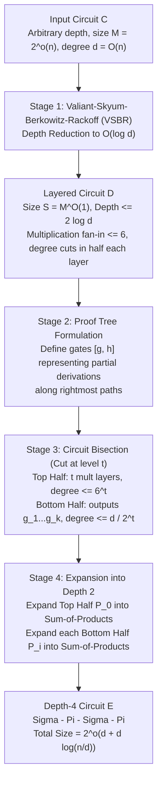

# Proof Architecture: Top-Down Blueprint

The proof of Theorem 2.4 converts an arbitrary circuit $C$ into a depth-4 circuit $E$ without blowing up the size beyond $2^{o(n)}$.

---

## The Four Stages of the Transformation

### 1. Stage 1: Classical Depth Reduction to $O(\log d)$
From classical results by Valiant et al. (1983) and Allender, Jiao, Mahajan, Vinay (1998), any circuit $C$ of size $M$ and degree $d$ can be restructured into a circuit of depth $O(\log d)$ and size $M^{O(1)}$.

### 2. Stage 2: Structural Refinement into Circuit $D$
Agrawal and Vinay refine this construction so that circuit $D$ satisfies strict invariants:
- Strictly alternating addition and multiplication layers.
- Multiplication fan-in is at most 6.
- The degree of every child of an addition gate equals the parent gate degree.
- **Key Invariant**: Every child of a multiplication gate has degree at most **half** the degree of the parent gate:
  $$\deg(\text{child}) \le \frac{1}{2} \deg(\text{parent})$$

### 3. Stage 3: Bisecting Circuit $D$ at Level $t$
Choose a parameter $t = \frac{1}{2} \log_6 \ell$.  
Cut circuit $D$ into two halves:
- **Top Half**: Exactly $t$ multiplication layers. Since multiplication fan-in $\le 6$, the total degree of the top half as a polynomial $P_0(y_1, \dots, y_k)$ is at most $6^t$.
- **Bottom Half**: Computes intermediate polynomials $P_1(x), \dots, P_k(x)$ at gates $g_1, \dots, g_k$. Because degree halves at each mult layer, the degree of each $P_i$ is at most $\frac{d}{2^t}$.

### 4. Stage 4: Sum-of-Products Expansion into Depth 4
- Write $P_0(y_1, \dots, y_k)$ as a brute-force sum of products (depth 2).
- Write each $P_i(x_1, \dots, x_n)$ as a brute-force sum of products (depth 2).
- Plug $P_i$ into $P_0$. The composition of two depth-2 circuits yields a **depth-4 circuit $E$** ($\Sigma\Pi\Sigma\Pi$).
- By choosing $t$ and $\ell$ optimally, the binomial coefficients $\binom{S+6^t}{6^t}$ and $\binom{n + d/2^t}{d/2^t}$ are both bounded by $2^{o(d + d \log(n/d))}$!
