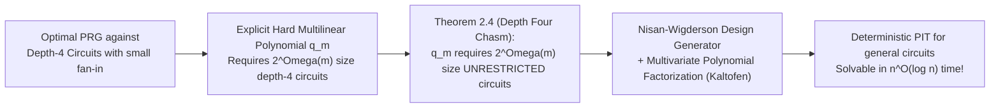

# Deep Dive: Black-Box PIT Derandomization

## 1. What is Polynomial Identity Testing (PIT)?

Given an arithmetic circuit $C(x_1, \dots, x_n)$, does it compute the identically zero polynomial ($C \equiv 0$)?
- **Randomized Algorithm (Schwartz-Zippel Lemma, 1979)**: Pick random values $r_1, \dots, r_n \in S \subseteq \mathbb{F}$. Evaluate $C(r_1, \dots, r_n)$. If $C \not\equiv 0$, it evaluates to non-zero with high probability.
- **The Open Challenge**: Can we do this **deterministically** in polynomial time without randomness?
  - *White-box*: The algorithm can inspect the internal wires of $C$.
  - *Black-box*: The algorithm can only feed inputs into $C$ and observe outputs (equivalent to designing a hitting set or pseudorandom generator).

---

## 2. Hardness vs Randomness in Algebraic Circuits

In Boolean complexity, Nisan and Wigderson (1994) showed that Boolean circuit lower bounds yield pseudorandom generators (derandomizing BPP to P).  
Kabanets and Impagliazzo (2004) proved the algebraic equivalent:
$$\text{Hard multilinear polynomials} \implies \text{Deterministic PIT}$$

Agrawal (2005) proved that a pseudorandom generator against depth-4 circuits yields a multilinear polynomial $q_m$ requiring exponential-sized depth-4 circuits.

---

## 3. The Agrawal-Vinay Reduction for PIT (Theorem 3.2)

### Proof Sketch of Theorem 3.2:
1. Assume there is an optimal pseudorandom generator $f$ against depth-4 circuits with second-layer fan-in $O(\ell(n))$ and bottom-layer fan-in $O(\log n)$.
2. By Agrawal (2005), this generator gives an explicit multilinear polynomial family $\{q_m\}$ requiring depth-4 circuits of size $2^{\Omega(m)}$.
3. By the **Depth Four Chasm Theorem (Theorem 2.4)**, any polynomial requiring exponential depth-4 circuits requires **exponential circuits of unrestricted depth**!
4. Plug this hard polynomial $q_m$ into the Nisan-Wigderson combinatorial design:
   - For an $n$-input circuit $C(z_1, \dots, z_n)$, substitute $z_i = p_i = q_{d \log n}(x_{S_i})$.
   - If $C(z) \neq 0$ but $C(p) = 0$, by Kaltofen's polynomial factorization algorithm, one can construct a small circuit computing $q$, contradicting its hardness!
5. Evaluating the substituted circuit over $O(\log n)$ variables takes $n^{O(\log n)}$ time, completing the derandomization.
