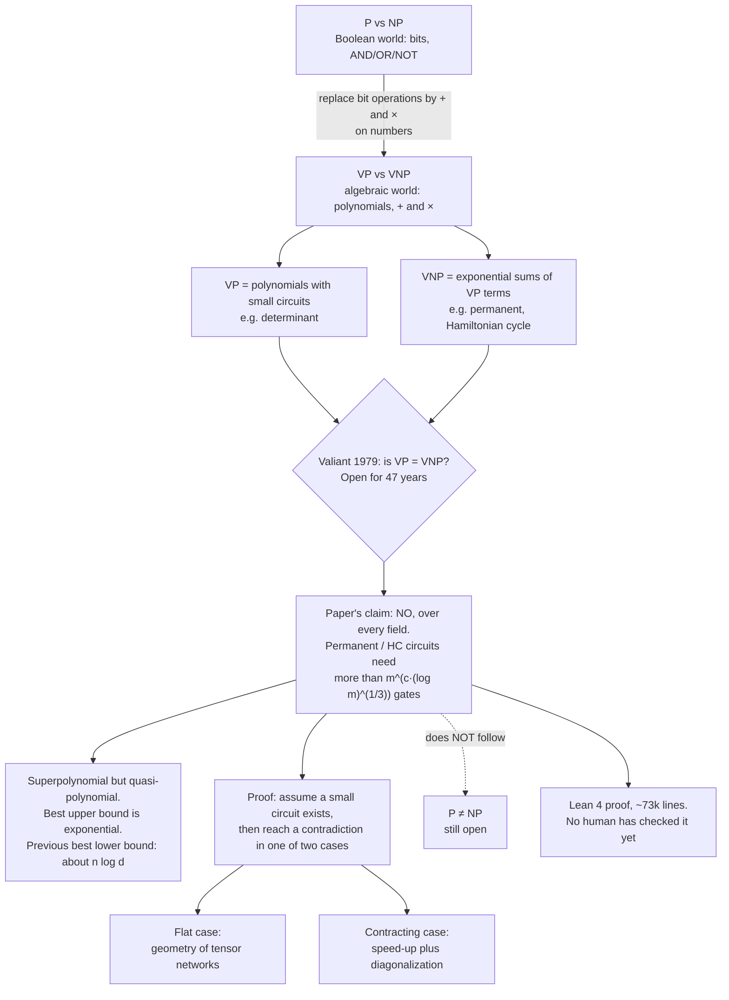

# Big picture

## One-paragraph version
Computing the **permanent** of an m×m matrix is believed to need exponentially many arithmetic operations if you want a formula that works symbolically, for all numbers rather than just 0/1. Nobody could prove even a *superpolynomial* lower bound for general circuits. The paper claims one: roughly m^{c·(log m)^{1/3}}. It reaches this through a dichotomy about the geometry of certain "price" metrics on tensors. Either the geometry is Euclidean-capable (flat case) or it is strictly contracting (contracting case), and each case yields a contradiction with a small circuit. It does not prove P ≠ NP.
