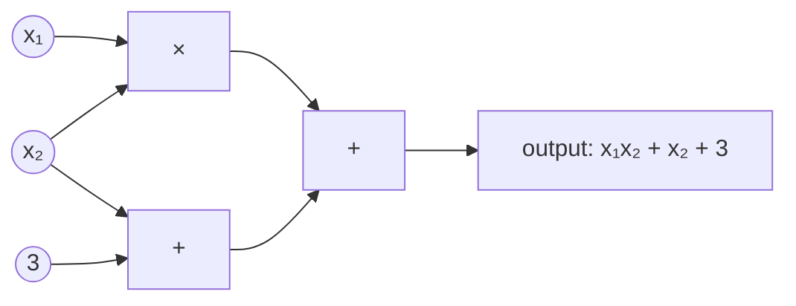

# Arithmetic circuits and the permanent

## Arithmetic circuit *(paper §1.3)*
A list of polynomials. Each entry is a variable, a constant, or the sum or product of two earlier entries. **Size = length of the list.** Variables and constants count as gates.

## VP and VNP *(paper §1.3)*
- **VP**: families (fₙ) where the number of variables, the degree and the circuit size are all bounded by a polynomial in n.
- **VNP**: fₙ(x) = Σ over e ∈ {0,1}^r(n) of gₙ(x, e), where g is in VP. That is an exponential sum of easy terms.

## The two stars
For an m×m matrix of variables:

- **Permanent** PERMₘ = Σ over σ ∈ Sₘ of Π x_{i,σ(i)}. It sums over all m! permutations.
- **Hamiltonian cycle polynomial** HCₘ = the same sum, restricted to the (m−1)! single-cycle permutations.

Both are **VNP-complete**: Valiant showed that any VNP family reduces to them. Over fields of characteristic ≠ 2 the permanent is complete. Over characteristic 2 the permanent equals the determinant (signs vanish), so it is easy there. HC is complete over *every* field. That is why the theorem is stated for HC over all fields and for the permanent when char ≠ 2.

## The determinant is the "easy twin"
Det and Perm differ only in the signs of terms. The determinant has polynomial-size circuits (Berkowitz 1984). The permanent is conjectured not to.

## Upper bounds
Best known circuits for the permanent are exponential, 2^{O(m)} (Ryser 1963 and later). The paper's lower bound is quasi-polynomial, 2^{Ω((log m)^{4/3})}. **Between the two there is still a huge gap**, which the paper acknowledges *(paper)*.
