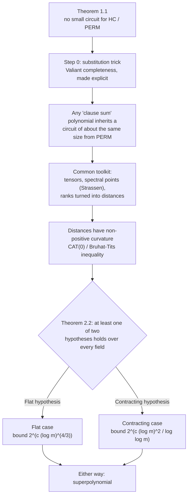

# Proof architecture (top-down)

The proof is by contradiction. **Assume the permanent (or HC) has a small circuit, then derive an impossibility.** The paper's Figure 1 and §2 give this structure.

## The four ideas to hold in your head
1. **Reduce to a friendlier polynomial.** Because PERM and HC are VNP-complete, a small PERM circuit gives a small circuit for any *clause sum*: a sum over bit vectors of products of local weights. The proof studies one specially chosen clause sum in each case. This is the **only** place the permanent is used (arrows "P" in the paper's Fig. 1).
2. **Look inside the circuit just twice** (arrows "C"). One step splits the polynomial at a balanced cut into pieces of rank ≤ L, as in classic depth reduction. The other evaluates the low-degree part of the output cheaply.
3. **Turn ranks into distances.** A tensor of rank ≤ r across a split behaves like a network with two "hubs" joined by a wire of dimension r. A *spectral point* φ (Strassen's asymptotic spectrum) assigns a "length" to such networks. *(analogy)* It is a way to price how expensive a tensor network is.
4. **A dichotomy about the geometry of those prices.** Prices always have non-positive curvature, which is the CAT(0) property. Over 𝔽₂-matrix configurations they are either capable of being fully Euclidean (**flat**) or strictly less than Euclidean by a fixed factor (**contracting**). The paper does not know which holds, but proves at least one does, and handles both.

Why the dichotomy is clever: you don't need to know which world you live in. You win in both.

## Why this might avoid known barriers *(paper's own discussion)*
- **Rank methods barrier**: the proof uses *spectral points*, not ranks, though these are only shown to exist via Zorn's lemma.
- **Natural proofs / algebrization / relativization**: the paper says algebraically natural proofs may be unable to give superpolynomial bounds for general circuits, and that it has **not analysed** relativization or algebrization. An expert reviewer will want to see this addressed. See [[12 How to evaluate it yourself]].
