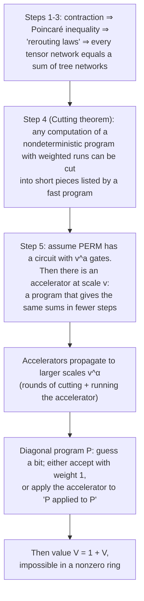

# Contracting case: speed-up plus diagonalization

**When it applies:** for some μ, every price on the 𝜇×𝜇 matrices over 𝔽₂ falls short of a Euclidean rectangle by a fixed factor. Geometry is "bent inward".

The argument is **indirect**. It resembles the diagonal proofs of computability and complexity theory, which is why the paper calls it a diagonalization.

## Plain-language reading *(analogy)*
1. Without any circuit at all, the geometry forces a structure theorem: long computations can be chopped into small independent pieces.
2. A small permanent circuit would be a **magic shortcut** that evaluates sums over runs faster than the structure theorem allows.
3. Use the shortcut to build a program that talks about itself: the **V = 1 + V** paradox, like the halting problem. Contradiction.

## Technical flags *(paper)*
- The permanent is used once, via a clause-sum circuit for Φ = Σ_w U_t(w)·y^w. This polynomial encodes runs of a fixed universal automaton.
- The "evaluation lemma" looks inside the circuit at the low-degree part. Correctness of an accelerator is a family of polynomial identities, so it survives reduction to a finite field.
- The bound is limited by the condition (log v)^{O(a)} ≤ v and gives 2^{c(log m)²/log log m}.
- Constants depend on μ, for which the proof gives **no value**. That is why m₀ is not explicit.
