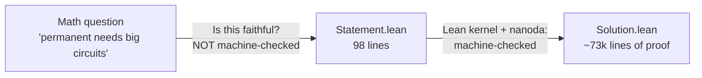

# Lean formalization and what it checks

## What exists *(paper §3 and secondary reports)*
- Repository: `github.com/anthropics/formal-math`, folder `vp-vnp`. Lean 4.33.1 with Mathlib.
- About **324 files, ~73,000 lines** (counts from press and blog reports).
- Every numbered statement has a Lean counterpart **except Remark N.6** (the determinantal-complexity consequence).
- The paper says the development contains no `sorry` outside `Challenge.lean`, and uses only the standard axioms `propext`, `Classical.choice` and `Quot.sound`.
- `Statement.lean` (≈98 lines, imports only Mathlib) defines circuits, PERM, HC, VP, VPBar, VNP and states the theorems. `Solution.lean` proves them. `Challenge.lean` states the theorems without proofs so outsiders can try to check them.
- Reported automated checks: **Comparator** (checks the proved theorem against the bare statement) and **nanoda** (an independent proof re-checker). These ran inside the project and are **not independent reviews**.

## What a green Lean check does and does not mean

- **Right-hand arrow**: strongly checked. If Lean accepts it, the proof proves the typed statement. Bugs in the 73k lines would be caught.
- **Left-hand arrow**: only human judgment can verify. If a definition were subtly wrong (say, circuits that cheat, or a vacuous VP), the theorem could be true and trivial. The README says so itself, and the paper (Appendix Q.1) says whether the statements say what is meant "was judged only by AI readers", and that no human has checked the development, the statement file or the proofs.

## So what is the confidence structure?
| Layer | Status |
|---|---|
| Proof ⇒ typed statement | machine-checked, with the project's own checkers |
| Typed statement = Valiant's conjecture | **not yet reviewed by a human specialist** |
| Remark N.6 (GCT consequence) | informal only |
| Paper's prose matches Lean | claimed, not independently audited |

The key human task is small: **read 98 lines**. See [[12 How to evaluate it yourself]].
